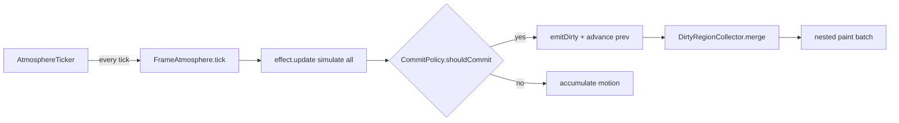

# Requirements

### Overview & Goals
Reduce the CPU cost of particle rendering (target: noticeably fewer repainted rectangles per second than today's ≈10 % of a core when the user is active) **without** visible loss of smoothness. The chosen strategy is **adaptive commit**: a particle is repainted only when its on-screen state would visibly change, so slow/far particles skip ticks while fast ones keep their full rate.

### Why this is the right lever (from investigation)
- Per `docs/overlay-investigation.md` §10.3/§12, the cost of a tick is dominated by the **number of dirty rectangles** (≈0.45–0.58 ms each, because every nested `contentPane.paintImmediately` re-renders the IDE components beneath), not by particle math.
- Today all three effects (`SnowEffect`, `FirefliesEffect`, `SakuraEffect`) commit a particle as soon as it moved `MOVE_EPSILON = 0.02 px` or its alpha changed by 1 of 256 steps. On a normal tick this means **almost every particle is dirty on every tick**, even particles that moved 0.1 px (≈0.2 device px on Retina), which is invisible.
- Painting rate of a particle should depend on how far it has moved, not on the timer rate.

### Scope
**In scope**
- A shared commit policy (movement threshold, alpha-step threshold, max-staleness bound) used by Snow, Fireflies and Sakura.
- Governor / calm retuning that follows from cheaper ticks.
- Stats needed to verify the saving (commit ratio / rects per second).
- Tests and docs/CHANGELOG updates.

**Out of scope**
- Background snapshot / blit caching of IDE pixels (risky; rejected by the user).
- Changing idle behaviour (calm mode stays at 15 FPS; no extra idle fade-out).
- Changing the glass-pane / nested-batch painting architecture, `DirtyRegionCollector` cost model, or the `AtmosphereEffect` contract.

### Functional Requirements
- Sub-pixel rendering and the on-screen-state invariant (`prevX/prevY/prevAlpha` advance only when a region covering old+new is reported) remain intact: no ghosting, no uncleared trails.
- A particle's visible hop per repaint stays below ≈0.7 device px for slow particles; a particle is never left un-repainted for more than a bounded number of ticks (max staleness) while it keeps moving.
- Fade-ins, event reactions (updraft, gust, dim) and cursor avoidance still look continuous.

### Non-Functional Requirements
- Hot path stays allocation-free; no new per-tick objects.
- Working in HiDPI and 1× displays (threshold expressed in user px, tuned for ≥ 0.5 device px).

# Technical Design

### Current Implementation
- `AtmosphereTicker` (Swing timer, `FrameBudgetGovernor` 20–30 FPS, 100 000 µs/s budget, `calm` 15 FPS) calls `FrameAtmosphere.tick`.
- `FrameAtmosphere.tick` → `effect.update(delta, bounds, collector)` → `collector.merge` → `route` → queued content rects painted as one nested `paintImmediately` batch (`AtmospherePainter.nestedPaint`).
- Each effect's `update` ends with:
  ```kotlin
  val moved = abs(x[i]-prevX[i]) >= MOVE_EPSILON || abs(y[i]-prevY[i]) >= MOVE_EPSILON   // 0.02f
  val faded = alphaIndex(alpha[i]) != alphaIndex(prevAlpha[i])                           // 1/256 step
  if (moved || faded) changed = emitDirty(...) or changed
  ```
  (`SnowEffect.kt:287`, `FirefliesEffect.kt:266`, `SakuraEffect.kt:258-263`, which also adds a rotation term).
- `emitDirty` reports `prev ∪ new` and commits the new state as painted, so un-committed motion simply accumulates — the mechanism needed for adaptive commit already exists.

### Key Decisions
1. **Decouple paint rate from tick rate.** Simulation keeps running every tick (cheap); a particle is *committed* (reported dirty + prev state advanced) only when `|Δ| ≥ MOVE_THRESHOLD` (≈0.4 user px ≈ 0.8 device px on 2×) or alpha moved ≥ `ALPHA_THRESHOLD` steps (≈3/255) or it has been stale for ≥ `MAX_STALE_TICKS`. Rationale: paint cost scales with commits; per-particle paint frequency becomes `speed / threshold` capped by the tick rate.
2. **One shared helper** (`core/CommitPolicy`) rather than three copies of the thresholds, so tuning lives in one place and is unit-testable.
3. **Force-commit cases:** respawn/vanish and population changes keep using `emitVanish`/`resize` unchanged; fade-in (alpha delta already exceeds threshold per tick), and cursor-avoidance steering naturally exceed the threshold, so they stay smooth.
4. **Governor:** with fewer commits a tick is cheaper, so the governor stays at its 30 FPS ceiling; this is desirable (fast particles get smoother) and costs little because quiet ticks are nearly free (`!changed` returns before any paint). Budget is lowered (e.g. 100 000 → 70 000 µs/s) so it can still shed load in busy IDE states.
5. **Staleness bound via a per-particle tick counter** (`IntArray`/`ByteArray`, structure-of-arrays like the rest) incremented in `update`, reset in `emitDirty`/`emitVanish`.

### Proposed Changes
```kotlin
// core/CommitPolicy.kt
object CommitPolicy {
    const val MOVE_THRESHOLD = 0.4f      // user px
    const val ALPHA_STEP_THRESHOLD = 3   // of 256 steps
    const val MAX_STALE_TICKS = 4

    @JvmStatic fun shouldCommit(dx: Float, dy: Float, alphaStepDelta: Int, staleTicks: Int, moveThreshold: Float = MOVE_THRESHOLD): Boolean =
        abs(dx) >= moveThreshold || abs(dy) >= moveThreshold ||
        alphaStepDelta >= ALPHA_STEP_THRESHOLD ||
        (staleTicks >= MAX_STALE_TICKS && (dx != 0f || dy != 0f || alphaStepDelta > 0))
}
```
- `SnowEffect`, `FirefliesEffect`, `SakuraEffect`: replace the `moved/faded` expressions with `CommitPolicy.shouldCommit(...)`; add a `stale` counter array; reset it where `prev*` is advanced. Sakura keeps its rotation term (`Δrot × size` compared to the same threshold). Remove/deprecate per-effect `MOVE_EPSILON` (keep a thin alias only if tests reference it).
- Fireflies: pulse alpha changes are periodic and smooth — the alpha threshold alone removes most of the twinkle-only repaints.
- `FrameBudgetGovernor` default budget and `AtmosphereStats`: add `commitRatio` (rects ÷ particles) or rects/second to the periodic stats line so before/after can be compared on the same frame.

### Components Affected
| File | Change |
|---|---|
| `core/CommitPolicy.kt` (new) | shared thresholds + decision function |
| `effects/snow/SnowEffect.kt` | use policy, stale counter |
| `effects/fireflies/FirefliesEffect.kt` | use policy, stale counter |
| `effects/sakura/SakuraEffect.kt` | use policy (+ rotation), stale counter |
| `render/FrameBudgetGovernor.kt` | retuned default budget |
| `render/AtmosphereStats.kt` | rects/s or commit-ratio field |
| `docs/overlay-investigation.md`, `CHANGELOG.md` | new §13 "Adaptive commit" with measured results |
| tests under `src/test/.../effects/*`, `core/`, `render/` | updated/added |

### Architecture Diagram


### Risks
- **Visible stepping of slow particles** if threshold too large → threshold ≤ ~0.8 device px and `MAX_STALE_TICKS` bound; tune via sandbox run.
- **Synchronised bursts** (many particles committing the same tick) → speeds are randomised, so accumulation phases differ; verified via per-tick rect histogram in stats.
- **Existing tests** assert near-all particles dirty per tick (`SnowEffectTest` ~l.210, `FirefliesEffectTest` ~l.98) → rewrite to assert the invariant (screen state covered by reported regions) and the reduced commit ratio.
- **Governor interplay:** cheaper ticks push FPS to 30; saving relies on commits depending on displacement, not tick rate — checked in tests with different deltas.

# Testing

### Validation Approach
Unit tests (JUnit, existing `*EffectTest` helpers `simulate`/`newCollector`) plus a before/after stats comparison; no sandbox required for the automated part (`./gradlew test`).

### Key Scenarios
- `CommitPolicyTest`: below-threshold motion → no commit; threshold crossing → commit; alpha step threshold; stale-bound forces commit; zero motion never commits.
- Per effect: over N simulated seconds at 20 and 30 FPS the total number of reported regions drops substantially versus committing every tick (assert ratio, e.g. ≤ 70 % for Snow), while the fastest particles are still reported ~every tick.
- **Invariant tests:** after each `update`, every particle's difference between simulated and painted position is ≤ threshold + epsilon, and every position change of `prev*` was covered by a reported region (existing coverage tests for cursor avoidance must still pass).
- Fade-in and respawn do not pop (alpha/vanish regions still reported).

### Edge Cases
- Tiny timer hiccup deltas (0.1 ms) report nothing; large clamped deltas (0.1 s) commit everything moving.
- `uiScale` ≠ 1, cursor avoidance steering, `SUCCESS`/`FAILURE` events mid-motion.
- Population resize while particles hold un-committed motion.

### Test Changes
Update `SnowEffectTest`, `FirefliesEffectTest`, `SakuraEffectTest` assertions that rely on `MOVE_EPSILON = 0.02`; add `CommitPolicyTest`; extend `AtmosphereStatsTest`/governor tests if the budget default changes.

# Delivery Steps

### ✓ Step 1: Add shared CommitPolicy and commit-ratio stats
A unit-tested `CommitPolicy` exists and the stats line exposes how many rectangles are painted per second, enabling before/after comparison.

- Create `core/CommitPolicy.kt` with `MOVE_THRESHOLD`, `ALPHA_STEP_THRESHOLD`, `MAX_STALE_TICKS` and `shouldCommit(dx, dy, alphaStepDelta, staleTicks)`.
- Add `CommitPolicyTest` covering sub-threshold, threshold crossing, alpha step, staleness bound and zero-motion cases.
- Extend `render/AtmosphereStats.kt` (and its report line) with rects/second or commit ratio; update its test.

### ✓ Step 2: Apply adaptive commit to SnowEffect and FirefliesEffect
Snow and Fireflies repaint a particle only when the policy says its on-screen state visibly changed, with the painted-state invariant preserved.

- Add a per-particle stale-tick array to both effects; increment in `update`, reset in `emitDirty`/`emitVanish`/spawn.
- Replace the `moved`/`faded` expressions (`SnowEffect` ~l.287, `FirefliesEffect` ~l.266) with `CommitPolicy.shouldCommit`, computing the alpha step delta via `alphaIndex`.
- Remove or alias `MOVE_EPSILON` and update KDoc that claims "almost every particle is dirty on every tick".
- Update `SnowEffectTest` / `FirefliesEffectTest`: replace near-all-dirty assertions with commit-ratio and coverage-invariant assertions; keep fade-in, respawn and cursor-avoidance coverage tests green.

### ✓ Step 3: Apply adaptive commit to SakuraEffect
Sakura uses the same policy, including its rotation term, with no visible trails.

- Add stale counter to `SakuraEffect`; replace the `moved || rotated || faded` check (~l.258-263) with `CommitPolicy.shouldCommit`, treating `Δrotation × size` as extra displacement.
- Reset the counter wherever `prevX/prevY/prevRotation/prevAlpha` advance.
- Update `SakuraEffectTest` for the reduced commit ratio and the coverage invariant.

### ✓ Step 4: Retune governor, document results and run the test suite
Cheaper ticks no longer inflate the frame rate or CPU, and the change is documented with measured numbers.

- Lower the `FrameBudgetGovernor` default budget (≈100 000 → 70 000 µs/s) and adjust `FrameBudgetGovernorTest` / ticker tests accordingly; keep `calm` at 15 FPS.
- Add §13 "Adaptive commit" to `docs/overlay-investigation.md` (rationale, thresholds, expected vs. measured rects/s) and an entry in `CHANGELOG.md`.
- Run `./gradlew test` and fix regressions; note that final threshold tuning (0.4 px / staleness 4) should be confirmed in a `runIde` session using the new stats line.