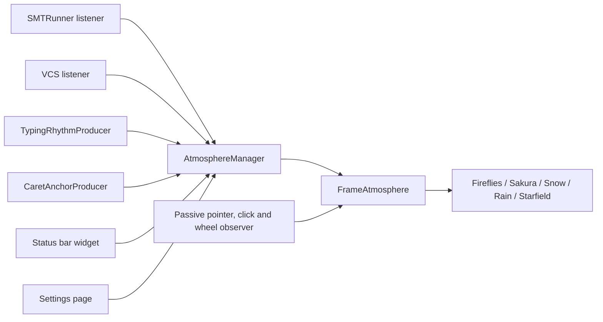

# Requirements

### Overview & Goals
Extend IDE Atmosphere with high-yield, low-overhead features across four practical directions: **new atmospheres** (Rain, Starfield), **more IDE reactions** (test results, typing rhythm, VCS), **settings & UX** (Reduce Motion, status bar widget, per-theme presets), and **passive interactions** (pointer modes, click burst, scroll gust, caret anchor). Low-utility, noisy, or speculative features—specifically Aurora bands, rigid preset bundles, and heuristic seasonal/auto modes—are excluded to maximize reliability, performance, and overall user utility.

### In Scope
- **New atmospheres:**
  - `Rain`: streaks, subtle splashes, and a motion-only brightness flash on failure.
  - `Starfield`: slow twinkling stars with occasional shooting stars; optimized for dark themes with a soft slate light-theme variant.
- **More IDE reactions:**
  - Test runner results: single SUCCESS or FAILURE event per test run via `SMTRunnerEventsListener`.
  - Typing rhythm: continuous smoothed flow level (`0..1`) accelerating particle activity during sustained typing.
  - VCS events: commit and push notifications mapped to gentle success reactions.
- **Settings & UX:**
  - Reduce Motion option: lowers speed, caps ticker FPS, and disables bursts/gusts for motion-sensitive users.
  - Status bar widget: quick popup to toggle/switch atmosphere, snooze for 1 hour, or open settings.
  - Per-theme effect configuration: independent selection for light and dark themes (`darkEffectId` / `lightEffectId`).
- **Passive interaction:**
  - Pointer mode: `AVOID`, `ATTRACT`, or `OFF` (migrating legacy `avoidMouse`).
  - Click burst: subtle outward particle displacement on mouse click.
  - Scroll gust: editor mouse-wheel scrolling applies a directional gust to particles.
  - Caret anchor: optional soft attraction towards the active editor caret position (opt-in, disabled by default).

### Out of Scope
- Aurora effect (high visual noise, rendering overhead, low net utility).
- Presets system (redundant state bundling; users configure individual preferences directly).
- Auto / seasonal weather heuristic (unreliable approximation of external reality; causes user confusion).
- Floating/detached tool windows, Welcome screen overlays, ambient audio, and public plugin extension points.
- Debugger pauses, code inspection count tension, and Pomodoro timers.

### User Stories
- As a user, I want subtle Rain and Starfield atmospheres so the IDE aesthetic matches my focus and theme.
- As a user, I want the atmosphere to react dynamically to test runs, VCS actions, and typing flow so the environment feels responsive without being distracting.
- As a user, I want to switch atmospheres or snooze for an hour directly from the status bar without opening Settings.
- As a motion-sensitive user, I want a Reduce Motion setting that minimizes velocity and frame rates.
- As a user, I want editor interactions like scrolling and caret focus to create organic, non-intrusive particle motion.

### Functional Requirements
- Rain and Starfield implement `AtmosphereEffect` with zero per-frame heap allocations and strict dirty-region bounding.
- Test runner integration publishes at most one outcome per test execution.
- Reduce Motion scales effective speed down, caps frame rate, and suppresses click bursts and scroll gusts.
- Pointer mode migrates existing `avoidMouse` boolean seamlessly (`true` → `AVOID`, `false` → `OFF`).
- Scroll gusts and caret anchors operate purely passively through AWT listeners without consuming input events.
- Settings UI provides direct, unambiguous control over sliders, toggles, and light/dark theme pairings without extraneous preset layers.

### Non-Functional Requirements
- CPU utilization remains bounded within the ≈ 10% budget via `FrameBudgetGovernor`.
- Strict backward compatibility with existing configuration state (`ide-atmosphere.xml`).
- Compatibility across IntelliJ Platform 2025.3+ builds with optional-safe IDE listeners.

# Technical Design

### Current Implementation
- `core/AtmosphereEffect` defines the lifecycle and simulation contract (`start`, `stop`, `update`, `paint`, `onEvent`, `onPaletteChanged`, `onPointerChanged`, `setFlow`, `onScroll`, `setAnchor`, `setIntensity`, `setSpeedScale`).
- `effects/AtmosphereEffects` maintains the registered factory map (`fireflies`, `sakura`, `snow`, `rain`, `starfield`).
- `core/AtmosphereEvent` handles discrete events dispatched through `AtmosphereManager`.
- `core/CursorAvoidance` manages steering vectors, velocity damping, attract/avoid forces, click bursts, and scroll gusts.
- `settings/AtmosphereSettingsState` persists user settings with automatic validation and legacy migration.

### Key Decisions
- **Exclude low-utility features:** Aurora, preset bundles, and seasonal auto heuristics are eliminated to minimize maintenance complexity, CPU overhead, and user annoyance.
- **Allocation-free effects:** Rain and Starfield use structure-of-arrays storage, pre-computed alpha lookup tables, and dirty bounding commit policies.
- **Continuous flow for typing:** Keystroke rates are smoothed into a single continuous `0.0..1.0` flow value to avoid event queue flooding.
- **Passive event observation:** Mouse clicks, wheel scrolling, and caret positions are captured via non-consuming preprocessors and listeners (`IdeEventQueue`, `EditorFactory.getEventMulticaster()`).
- **Unified pointer steering:** `CursorAvoidance` centralizes avoid/attract vectors, impulse bursts, scroll gusts, and caret anchor attractions using shared velocity arrays.
- **Light/Dark theme resolution:** `AtmosphereManager.refreshPalette()` inspects theme luminance and resolves `darkEffectId` / `lightEffectId` with fallback to `effectId`.

### Data Models / Contracts
```kotlin
enum class PointerMode { AVOID, ATTRACT, OFF }

data class State(
  var effectId: String = "fireflies",
  var intensity: Float = 1.0f,
  var speed: Float = 1.0f,
  var reactToActivity: Boolean = true,
  var pauseOnFocusLoss: Boolean = true,
  var reactToTyping: Boolean = true,
  var pointerMode: PointerMode = PointerMode.AVOID,
  var reduceMotion: Boolean = false,
  var darkEffectId: String? = null,
  var lightEffectId: String? = null,
  var caretAnchor: Boolean = false,
)

interface AtmosphereEffect {
  fun setFlow(level: Float) {}
  fun onPointerPressed(x: Float, y: Float) {}
  fun onScroll(x: Float, y: Float, amount: Float) {}
  fun setAnchor(x: Float, y: Float, active: Boolean) {}
}
```

### File Structure
- `effects/rain/RainEffect.kt`: Rain simulation with depth layers, splash particle pool, and motion-only storm reactions.
- `effects/starfield/StarfieldEffect.kt`: Starfield simulation with twinkling depth layers and shooting star triggers.
- `events/TestResultActivityProducer.kt`: SMTRunner listener for test execution success/failure outcomes.
- `events/TypingRhythmProducer.kt`: Continuous typing activity and flow level calculator.
- `events/VcsActivityProducer.kt`: VCS commit and push listener.
- `events/CaretAnchorProducer.kt`: Passive editor caret position tracker for frame root panes.
- `widget/AtmosphereStatusBarWidgetFactory.kt`: Status bar widget factory and popup actions.
- `core/PointerMode.kt`: Pointer interaction modes enum.
- `core/CursorAvoidance.kt`: Physics calculations for avoid, attract, burst, gust, and anchor steering.

### Architecture Diagram


### Risks
- High-frequency wheel/scroll events causing CPU spikes: mitigated by throttling gusts to ≥ 80 ms intervals and bounding maximum velocity.
- Caret tracking across multiple editors/splits: mitigated by resolving coordinates relative to the active frame root pane and deactivating when focus leaves the editor.
- Stray dirty rects from large rain streaks: bounded by `DirtyRegionCollector` capacity with automatic bounding box degradation if capacity is reached.

# Testing

### Validation Approach
Automated testing via unit and integration suites (`./gradlew test`), verified with plugin verification (`./gradlew verifyPlugin`) and full build checks (`./gradlew build`).

### Key Scenarios
- `RainEffect` & `StarfieldEffect`: dirty-region pixel coverage, zero allocations during update loops, scale handling across intensity and speed adjustments, dark/light palette transitions.
- `AtmosphereSettingsState`: serialization round-trip, migration of legacy `avoidMouse` settings to `PointerMode`, and default value stability.
- `CursorAvoidance`: repulsion, attraction with soft-radius dampening, radial click burst impulses, directional scroll gusts, and caret anchor attraction.
- `TypingRhythmProducer`: flow level ramp-up under continuous keystrokes and exponential decay back to baseline upon pause.
- `TestResultActivityProducer` & `VcsActivityProducer`: single outcome emission per action with appropriate success/failure mapping.
- `AtmosphereStatusBarWidget`: popup action execution, snooze duration timer, and immediate effect switching.

### Edge Cases
- Rapid successive test runs and VCS events.
- Rapid editor resizing and split-pane reconfigurations during active particle simulation.
- Power Save mode activations and frame focus transitions.

# Delivery Steps

### ✓ Step 1: Add Rain and Starfield atmospheres
Two new selectable atmospheres adhering to the allocation-free effect contract.

- Implement `RainEffect` with layered streak physics, landing splashes, and failure reaction.
- Implement `StarfieldEffect` with twinkling stars, shooting star scheduler, and dark/light palettes.
- Register both effects in `AtmosphereEffects` and add descriptive keys to `AtmosphereBundle.properties`.
- Add test suites for dirty-rect coverage, zero-allocation hot paths, and event reactions.

### ✓ Step 2: Settings & UX: Reduce Motion, status bar quick switch, per-theme configuration
Users can reduce motion, switch/snooze atmospheres from the status bar, and configure distinct light and dark theme effects.

- Extend `AtmosphereSettingsState.State` with `reduceMotion`, `darkEffectId`, and `lightEffectId` with clean XML serialization.
- Implement `Reduce Motion` mode: lower simulation speed, cap frame rates, and disable motion bursts.
- Add `PauseReason.USER_SNOOZE` and 1-hour snooze functionality to `AtmosphereManager`.
- Implement `AtmosphereStatusBarWidgetFactory` with quick popup controls (switch effect, snooze, open settings).
- Update `AtmosphereSettingsConfigurable` UI with theme-specific selectors and motion toggles.

### ✓ Step 3: Interaction: pointer modes and click burst
Passive pointer interactions for repulsion, attraction, and click burst impulses without consuming input events.

- Implement `PointerMode` (`AVOID`, `ATTRACT`, `OFF`) and migrate legacy boolean settings.
- Add attract steering and soft-radius dampening to `CursorAvoidance`.
- Add `onPointerPressed` to `AtmosphereEffect` and wire outward particle impulse handling.
- Register passive click observer in `FrameAtmosphere` and verify non-consuming event handling.

### ✓ Step 4: IDE reactions: test results, typing rhythm, VCS
Atmosphere dynamically reflects test results, typing flow, and VCS actions.

- Implement `TestResultActivityProducer` to publish test run outcomes via `SMTRunnerEventsListener`.
- Implement `TypingRhythmProducer` to track keystroke frequency and publish continuous flow values (`0..1`).
- Implement `VcsActivityProducer` for commit and push notifications.
- Connect continuous flow updates to `AtmosphereEffect.setFlow`.

### ✓ Step 5: Advanced interactions: scroll gust and caret anchor
Editor scrolling and active caret tracking provide responsive, natural particle motion.

- Add directional `gust` impulses and `setAnchor` attraction logic to `CursorAvoidance`.
- Extend `AtmosphereEffect` with default `onScroll` and `setAnchor` methods.
- Update `FrameAtmosphere` passive AWT listener to capture `MOUSE_WHEEL_EVENT_MASK` and dispatch throttled gusts.
- Implement `CaretAnchorProducer` to passively track editor caret coordinates and forward them to active effects when enabled.
- Add `caretAnchor` toggle to settings and configurable UI.

### ✓ Step 6: Documentation and verification
Ensure comprehensive documentation, clean changelog, and passing verification suites.

- Update `README.md` and `plugin.xml` to accurately reflect supported atmospheres and interaction features.
- Update `CHANGELOG.md` with additions and improvements.
- Execute full test suite (`./gradlew test`), project build (`./gradlew build`), and plugin verification (`./gradlew verifyPlugin`).