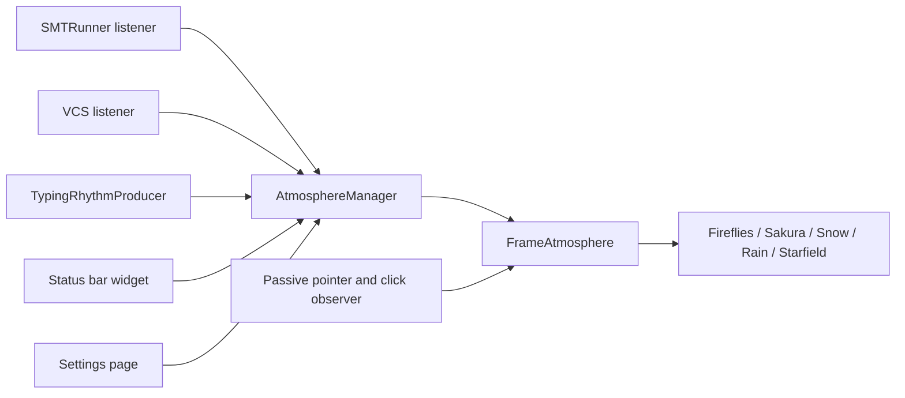

# Requirements

### Overview & Goals
Extend IDE Atmosphere beyond Fireflies/Sakura/Snow with four directions: **new atmospheres**, **more IDE reactions**, **settings & UX**, and **interaction**. Everything keeps the plugin's core promises: passive (never consumes input), motion-only reactions, cheap CPU, theme-aware.

### In Scope
- **New atmospheres:** `Rain` (streaks, splashes, lightning flash on failure expressed as motion/brightness only) and `Starfield` (twinkling stars with occasional shooting star; best on dark themes, soft variant on light).
- **More IDE reactions:**
  - Test-run results (all passed → SUCCESS, failures → FAILURE) from the test runner.
  - Typing rhythm: particles gently stir with typing speed and settle after a pause.
  - VCS: successful commit/push → SUCCESS-like reaction.
- **Settings & UX:**
  - Reduce Motion option (static-ish, very slow, low FPS; closes a README limitation).
  - Status bar widget with a popup to switch atmosphere and pause for 1 hour.
  - Optional light/dark preset: separate effect per theme brightness.
- **Interaction:** pointer mode **Avoid / Attract / Off** (replaces the `avoidMouse` boolean) and a click burst (particles puff outward from a mouse click, observed passively).

### Out of Scope
- Floating/detached windows, Welcome screen, ambient sound, public extension point, per-project effects (listed as later ideas).
- Debugger-pause, inspection-count and Pomodoro reactions.

### User Stories
- As a user I want rain or a starry sky so the IDE matches my mood.
- As a user I want the atmosphere to react when tests pass or fail, and to my typing, so it feels alive.
- As a motion-sensitive user I want a Reduce Motion switch.
- As a user I want to switch or pause the atmosphere from the status bar without opening Settings.

### Functional Requirements
- New effects appear in the Settings picker with a one-line description and honour intensity, speed, idle/activity/success/failure events, pointer modes and the dirty-rect contract (no per-frame allocation).
- Test results fire exactly one outcome per test run; honours `reactToActivity`.
- Reduce Motion lowers speed and FPS cap and disables bursts/gusts; persisted.
- Existing persisted `avoidMouse` values migrate (`true` → Avoid, `false` → Off).
- Input is never consumed or altered by any new observer.

### Non-Functional Requirements
- Active-user CPU stays near the current ≈ 10 % budget; new effects governed by `FrameBudgetGovernor`.
- Compatible with the configured platform (`intellijIdea("2025.3.6.1")`); test-runner and VCS integration must be optional-safe.

# Technical Design

### Current Implementation
- `core/AtmosphereEffect` is the effect contract (`start/stop/update/paint/onEvent/onPaletteChanged/onPointerChanged/setIntensity/setSpeedScale`); effects are registered in `effects/AtmosphereEffects` (factory map) and are structure-of-arrays, allocation-free (see `effects/snow/SnowEffect`, `effects/fireflies/FirefliesEffect`).
- `core/AtmosphereEvent` has `ACTIVITY_STARTED/FINISHED, SUCCESS, FAILURE, USER_ACTIVE, USER_IDLE`; producers in `events/` publish through `AtmosphereManager.beginActivity/endActivity/publish` (see `events/ExecutionActivityProducer`, registered in `plugin.xml` `projectListeners`).
- `settings/AtmosphereSettingsState.State` (`effectId, intensity, speed, reactToActivity, pauseOnFocusLoss, avoidMouse`) is applied by `AtmosphereManager.applySettings()`; UI in `settings/AtmosphereSettingsConfigurable`.
- Pointer is observed passively in `frame/FrameAtmosphere` and forwarded via `onPointerChanged`; shared steering lives in `core/CursorAvoidance`.

### Key Decisions
- **Effects stay behind the existing contract.** Rain/Starfield only add classes under `effects/rain`, `effects/starfield` and one line each in `AtmosphereEffects`; painter/ticker/lifecycle are untouched.
- **Typing rhythm is a continuous value, not an event.** Add `AtmosphereEffect.setFlow(level: Float) {}` (default no-op, 0..1) so effects don't get event spam; a `TypingRhythmProducer` computes it from a smoothed keystroke rate and `AtmosphereManager` forwards it.
- **Pointer mode is an enum.** `PointerMode { AVOID, ATTRACT, OFF }` replaces `avoidMouse`; `CursorAvoidance` gains a sign/strength parameter (attract = inverse steering with a soft stop radius). Click burst via new default-no-op `AtmosphereEffect.onPointerPressed(x, y)`.
- **Passive input observation** via an `IdeEventQueue` event preprocessor/`Toolkit` AWT listener that always returns "not handled" (same philosophy as the existing pointer observer).
- **Reduce Motion** is a setting applied centrally: it scales `speed` down in `AtmosphereManager.applySettings()`, lowers the ticker cap, and makes effects ignore bursts/gusts through an `EffectContext` flag.
- **Test results** use `SMTRunnerEventsListener` (`TEST_STATUS` topic) in an optional listener; VCS via `CheckinHandler`/`VcsNotifier` or the `PushActionBase` listener, registered in an optional `<depends optional="true">` config file so platform-only IDEs still load.
- **Status bar widget** uses `StatusBarWidgetFactory` + `ListPopup` actions (switch effect, Pause 1 h, Open Settings); pause adds `PauseReason.USER_SNOOZE` to `AtmosphereManager`.

### Data Models / Contracts
```kotlin
enum class PointerMode { AVOID, ATTRACT, OFF }
data class State(
  var effectId: String, var intensity: Float, var speed: Float,
  var reactToActivity: Boolean, var pauseOnFocusLoss: Boolean,
  var pointerMode: PointerMode = PointerMode.AVOID,   // migrated from avoidMouse
  var reduceMotion: Boolean = false,
  var reactToTyping: Boolean = true,
  var darkEffectId: String? = null, var lightEffectId: String? = null,
)
interface AtmosphereEffect { fun setFlow(level: Float) {}; fun onPointerPressed(x: Float, y: Float) {} }
```

### File Structure
- New: `effects/rain/RainEffect.kt`, `effects/starfield/StarfieldEffect.kt`, `events/TestResultActivityProducer.kt`, `events/VcsActivityProducer.kt`, `events/TypingRhythmProducer.kt`, `widget/AtmosphereStatusBarWidgetFactory.kt`, `core/PointerMode.kt`, tests mirroring each.
- Modified: `AtmosphereEffects`, `AtmosphereEffect`, `CursorAvoidance`, `FrameAtmosphere`, `AtmosphereManager`, `AtmosphereSettingsState`, `AtmosphereSettingsConfigurable`, `plugin.xml`, `AtmosphereBundle.properties`, existing three effects (flow/click/attract), `README.md`, `CHANGELOG.md`.

### Architecture Diagram


### Risks
- Click/typing observers must never consume events → unit-test that handlers return "not handled".
- Rain streaks produce larger dirty rects → verify the governor/`DirtyRegionCollector` keep CPU near budget; fall back to fewer, shorter streaks.
- Test/VCS APIs may differ per IDE → optional dependency config and `verifyPlugin`.
- Settings migration must not break existing `ide-atmosphere.xml`.

# Testing

### Validation Approach
Unit tests mirroring the existing style (`./gradlew test`), plus `./gradlew build` and `./gradlew verifyPlugin`.

### Key Scenarios
- `RainEffect`/`StarfieldEffect`: dirty-rect coverage regression, no allocation in update/paint, intensity/speed scaling, success/failure/idle reactions, palette dark/light.
- `AtmosphereEffects` exposes the new ids; settings normalization falls back for unknown ids.
- `AtmosphereSettingsState`: `avoidMouse` → `PointerMode` migration; new fields round-trip.
- Producers: test-run result publishes exactly one SUCCESS/FAILURE; typing producer ramps flow up with keystrokes and decays to 0 after a pause.
- Pointer: ATTRACT pulls particles toward the cursor and stops at the soft radius; click burst displaces particles; observers never consume events.
- Reduce Motion lowers effective speed/FPS cap and disables bursts; Snooze pauses and resumes the ticker.

### Edge Cases
- Plugin disabled / Power Save / app inactive while new features fire.
- Rapid successive test runs and back-to-back previews.
- Frame resize while burst or flow is active.

# Delivery Steps

### ✓ Step 1: Add Rain and Starfield atmospheres
Two new selectable atmospheres that follow the existing effect contract.

- Create `RainEffect` (`effects/rain`) with depth layers, splashes and a motion-only failure reaction.
- Create `StarfieldEffect` (`effects/starfield`) with twinkling stars, a rare shooting star and dark/light palette variants.
- Register both in `AtmosphereEffects` and add descriptions to `AtmosphereBundle.properties` so they appear in the Settings picker.
- Add unit tests for dirty-rect coverage, allocation-free hot path, events and intensity/speed scaling, modelled on the existing Snow/Fireflies tests.

### ✓ Step 2: Settings & UX: Reduce Motion, status bar quick switch, per-theme presets
Users can reduce motion, switch or snooze the atmosphere from the status bar, and pick different effects for light and dark themes.

**Resumption state (work already in the tree from an interrupted run — finish it, do not redo it):**
- Done: `State.reduceMotion / darkEffectId / lightEffectId` + `effectIdFor(isDark)` + `effectiveSpeed()` in `AtmosphereSettingsState`; `PauseReason.USER_SNOOZE`, `snooze()/resumeFromSnooze()/isSnoozed/snoozeEndsAtMillis` in `AtmosphereManager`; `widget/AtmosphereStatusBarWidgetFactory.kt` + `widget/AtmosphereWidgetActions.kt`; Reduce Motion checkbox and per-theme combos in `AtmosphereSettingsConfigurable`; bundle keys; widget tests under `src/test/.../widget/`.
- Remaining (`./gradlew clean test --offline` → 352 tests, 22 failed):
  - `AtmosphereSettingsStateTest`: two XML-serialization expectations are stale (`six plain options only`, `round-trip through XML`) — fix the serialization so defaults are omitted or update the expectations to the new 9-option state, consistent with the existing `OptionTag`/default-skipping convention.
  - `BuildActivityProducerTest`, `DumbModeActivityProducerTest`, `ExternalSystemActivityProducerTest`, `ExecutionActivityProducerTest` fail with `NoSuchMethodError` for the old 6-arg `State.<init>` even after `clean` — find where a stale `State` class gets on the test classpath (instrumented/sandbox jar or a test helper constructing `State` positionally) and fix the root cause; the resulting empty-event assertions are a consequence of that.
  - Confirm `plugin.xml` registers the `statusBarWidgetFactory` and that `AtmosphereManager.refreshPalette()`/`applySettings()` use `effectIdFor(isDark)` and `effectiveSpeed()` (ticker FPS cap under Reduce Motion).

Original scope:
- Extend `AtmosphereSettingsState.State` with `reduceMotion`, `darkEffectId`, `lightEffectId` (normalized, round-trip tested).
- Apply Reduce Motion in `AtmosphereManager.applySettings()`: lower speed, cap the ticker FPS and suppress bursts/gusts.
- Add `PauseReason.USER_SNOOZE` and a 1-hour snooze.
- Implement `AtmosphereStatusBarWidgetFactory` with a popup (switch effect, snooze, open Settings) and register it in `plugin.xml`.
- Update `AtmosphereSettingsConfigurable` and use the per-theme effect id in `AtmosphereManager.refreshPalette()`.

### ✓ Step 3: Interaction: pointer modes and click burst
The pointer can repel or attract particles, and a mouse click puffs them outward, all without consuming input.

- Introduce `PointerMode` and migrate `avoidMouse`; update the Settings UI to a Avoid/Attract/Off selector.
- Extend `CursorAvoidance` with attract steering and a soft stop radius.
- Add `onPointerPressed` to `AtmosphereEffect` and implement it in all five effects.
- Add a passive click observer in `FrameAtmosphere`.
- Test attract/avoid behaviour, burst displacement and that the observer does not consume events.

### ✓ Step 4: More IDE reactions: test results, typing rhythm, VCS
The atmosphere reacts to test outcomes, typing flow and successful commits or pushes.

- Add `TestResultActivityProducer` (SMTRunner events) publishing one SUCCESS or FAILURE per run.
- Add `TypingRhythmProducer` computing a smoothed 0..1 level, forwarded through `AtmosphereManager` to the new `AtmosphereEffect.setFlow`, and implement `setFlow` in all five effects.
- Add `VcsActivityProducer` for commit/push success, registered through an optional-dependency config in `plugin.xml`.
- Add a `reactToTyping` toggle in settings.
- Add producer tests: single outcome per run, ramp-up and decay of the flow value.

### * Step 5: Docs, changelog and verification
README, CHANGELOG and plugin description reflect the new features, and the build and verifier pass.

- Update `README.md` (features, settings, limitations: Reduce Motion now exists) and the `plugin.xml` description.
- Add `CHANGELOG.md` entries under Unreleased.
- Run `./gradlew test`, `./gradlew build` and `./gradlew verifyPlugin`, and fix any regressions.