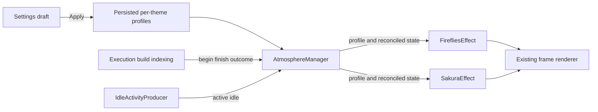
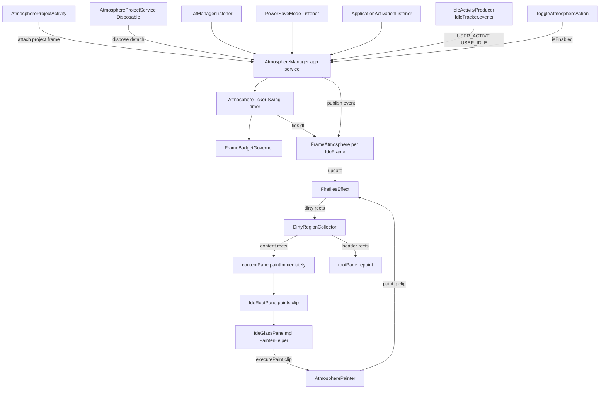
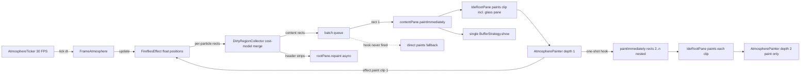

# Status

### Assessment
The original fireflies PoC and smoothness fix are complete and human-accepted. The next milestone has implementation recorded through historical steps 10–15, but final integration remains pending and several requirements need correction. This status and the active Requirements, Technical Design, Testing and Delivery Steps below supersede the collapsed historical specification; historical checkmarks do not certify the new acceptance criteria.

| Area | Evidence in the current repository | Remaining work |
|---|---|---|
| Frame-wide overlay and smooth motion | `AtmospherePainter`, `FrameAtmosphere`, nested batch repaints, 20–30 FPS governor; original visual checks accepted by the user | Preserve behavior; do not reopen the accepted CPU/smoothness trade-off |
| Settings | `settings/AtmosphereSettingsState.kt`, `AtmosphereSettingsConfigurable.kt`, `plugin.xml`: enable, theme, intensity, speed, activity reactions, focus-loss behavior | Correct live application and add settings-panel/actual serialization coverage |
| Second theme | `effects/sakura/SakuraEffect.kt` and `AtmosphereEffects` alongside Fireflies | Include Sakura in the settings/reaction regression checks |
| ADSR | `core/AdsrEnvelope.kt`; hard-coded movement and glow envelopes in both effects | Persisted, editable per-theme profiles; chosen by the user in this assessment |
| Activity | Execution, dumb-mode and project-task listeners registered in `plugin.xml`; per-project activity counts in `AtmosphereManager` | Neutral outcomes, reaction-toggle reconciliation, overlap/idle precedence |
| General background tasks | Only indexing/dumb mode is observed | Still an unmet portion of the requested background-task coverage, not a completed general-task integration |
| Cheap CPU tuning | `docs/overlay-investigation.md` §12: fixed cost 500,000 ns; densities 72,000 for Fireflies / 90,000 for Sakura | No further redesign in this slice; document limits honestly |
| Final integration/docs | Historical step 16 is unchecked; `README.md` still says no settings, other themes or extra producers | Complete regression coverage and refresh user-facing documentation |

### Verification boundary
- Git status is clean on `master` at assessment time.
- Recent IDE activity reports successful sandbox launches/builds. It does not establish a final full-suite or Plugin Verifier result for this milestone.
- No builds or tests were rerun during this planning assessment. The previously reported 97-test compatibility pass applies to the earlier smoothness milestone, not automatically to the current feature set.
- Recorded tuning results are approximately 10.1% active tick-cost CPU, 6.9% **estimated** calm CPU, and no animation ticks while faded/dormant. These are tick-time estimates, not independent process-wide CPU measurements. The original ≤3% aspiration remains unmet.

# Requirements

### Completion slice
Finish the existing Settings/Sakura/activity milestone without adding themes, replacing the rendering layer or sacrificing accepted smoothness.

- Add **per-theme ADSR profiles**, preserving Fireflies and Sakura defaults independently. Controls shape activity motion and success pulses; they do not alter the existing focus-loss fade or individual particle lifetimes.
- Changes take effect after Settings **Apply/OK**, on every registered frame, without a restart. Cancel/Reset must not apply draft edits.
- Intensity changes affect existing particles and particle count on the next update, without requiring a resize or respawn; removed particles' previous pixels are cleared.
- Speed is a baseline multiplier across normal, idle and busy motion, not only at rest. Activity takes precedence over user idle while work is running; finishing work restores idle or active behavior as appropriate.
- Turning reactions off resets transient visuals and calm mode to a neutral baseline, but must not discard balanced operation bookkeeping. Re-enabling, replacing the theme or attaching a new frame restores the current ongoing state without replaying old success/failure pulses.
- Indexing completion and aborted builds finish activity **without** success/failure reactions. Build success/error and Run/Debug exit-code outcomes retain meaningful reactions.
- Keep pause-on-focus-loss, Power Save precedence, multiple-project disposal, non-interactive painting and allocation-conscious hot paths intact.
- Refresh `README.md`, `CHANGELOG.md`, plugin description and investigation documentation to match the implemented features and measured limits.

### Scope boundaries
General background-task observation remains explicitly open: `DumbModeActivityProducer` observes indexing only, and `ProjectTaskListener` covers tasks delivered through that platform topic, not every Gradle/Maven command or background operation. This slice must not advertise universal coverage or introduce unsupported ProgressManager hooks. Additional task-specific integrations are deferred rather than silently marked complete.

New themes, Reduce Motion, weather/network access, public extension points and deeper rendering/CPU redesign remain out of scope.

# Technical Design

### Existing architecture to retain
`AtmosphereManager` is the app-level owner of project registrations, effect replacement, shared ticker, settings application and reaction fan-out. Settings use `PersistentStateComponent` in `ide-atmosphere.xml`; enabled state remains in `PropertiesComponent`. Both effects retain their array-backed simulation, committed `prev*` painted state and cached geometry/colors. Rendering continues through the existing glass-pane painter and bounded nested repaint batch.

### Per-theme reaction settings
- Extend `settings/AtmosphereSettingsState.kt` with serializable reaction profiles for `fireflies` and `sakura`. Each profile contains a movement envelope and a success-pulse envelope: attack/decay/release in seconds and sustain ratio. Defaults reproduce the current constructors in `FirefliesEffect` and `SakuraEffect`.
- Add typed `EnvelopeSettings`/`AtmosphereReactionProfile` contracts under `core/`, with validated finite durations (0–10 seconds) and sustain ratio (0–1). Normalize invalid loaded settings and unknown effect IDs safely; existing settings files without profiles get theme-specific defaults.
- Extend `AtmosphereSettingsConfigurable` with per-theme reaction sections using the existing Kotlin UI DSL and localized bundle text. Use an independent editable draft so changing the theme picker preserves unapplied edits to each theme; Apply commits once, Reset reloads persisted values, disposal discards drafts. Keep motion and success-pulse controls clearly labeled.
- Add a default-no-op `AtmosphereEffect.onReactionProfileChanged(profile)` seam. `AtmosphereManager.activate` and `applySettings` pass the selected effect's profile; changing themes does not overwrite the other theme's profile.
- Add runtime reconfiguration to `AdsrEnvelope`, preserving the current value and smoothly restarting the active segment rather than jumping. Movement uses normalized reaction levels around rest 1, with speed applied separately. Define sustain as interpolation between rest and peak for movement; for glow, rest is 0 so this is the usual fraction of peak. Hold movement until its state changes; success is a one-shot that auto-releases after attack/decay, never holds indefinitely. Preserve default glow decay behavior and zero-duration safety.

### Live controls and state reconciliation
- In both effects, retain an unscaled particle-opacity baseline and apply intensity during update. Flag population changes so count is recomputed on the next update even when bounds are unchanged; emit vanish/dirty regions against committed previous pixels.
- Compose speed independently: `effectiveSpeed = userSpeedScale * reactionMultiplier`. Include the slider in each effect's baseline motion dimensions; preserve bounded failure impulses and return toward the configured baseline.
- Track user idle and project busy independently rather than letting the last event overwrite the entire motion target. Busy wins; otherwise idle chooses the calm target, otherwise normal. Apply the same policy when a frame is activated or the effect is replaced.
- `AtmosphereManager` maintains activity bookkeeping regardless of `reactToActivity`; only visual publication is gated. Applying reaction settings off neutralizes existing effect reactions and ticker calm state; on reconciles from live counts and current idle state. Clear per-project bookkeeping on detach and guard queued callbacks after disposal.

### Correct activity outcomes
- Replace `endActivity(project, success: Boolean)` with an explicit outcome contract, for example `ActivityOutcome { SUCCESS, FAILURE, NEUTRAL }`. Keep start/finish transitions reference-counted and reject unmatched finishes rather than emitting spurious outcomes or negative counts.
- `DumbModeActivityProducer`: neutral finish; no success pulse for merely leaving indexing.
- `BuildActivityProducer`: aborted → neutral, errors → failure, otherwise success. Check abortion first. Map only events actually observed through `ProjectTaskListener`.
- `ExecutionActivityProducer`: preserve the documented zero/non-zero exit-code mapping. Do not claim every intentional process stop can be distinguished reliably by that callback.
- Preserve EDT dispatch and project targeting; success/failure are transient outcomes, not commands that release unrelated still-running activity.

### Data flow


### Files affected
Paths below are relative to `src/main/kotlin/info/chrzanowski/ideatmosphere/` unless stated otherwise.
- `core/AdsrEnvelope.kt`, `core/AtmosphereEffect.kt`, new reaction-profile and outcome contracts.
- `settings/AtmosphereSettingsState.kt`, `settings/AtmosphereSettingsConfigurable.kt`.
- `effects/fireflies/FirefliesEffect.kt`, `effects/sakura/SakuraEffect.kt`, `AtmosphereManager.kt`.
- `events/ExecutionActivityProducer.kt`, `events/BuildActivityProducer.kt`, `events/DumbModeActivityProducer.kt`.
- `src/main/resources/messages/AtmosphereBundle.properties`, `src/main/resources/META-INF/plugin.xml`, corresponding tests, `README.md`, `CHANGELOG.md`, `docs/overlay-investigation.md`.

### Risks and mitigations
- Editing active envelopes or decreasing intensity can cause jumps/stale pixels: preserve envelope continuity and compare offscreen before/after pixels against dirty regions.
- Settings changes during overlapping operations can strand busy state: separate bookkeeping from visual gating and reconcile deterministically.
- Higher slider values can raise rendering cost: retain the existing governor/population caps and document the accepted budget as a target, not a guaranteed hard ceiling.

# Testing

### Agent-checkable coverage
- Extend `AdsrEnvelopeTest`: configuration changes in every phase, non-zero rest sustain, continuity, zero durations, invalid/finite values, one-shot completion and release/retrigger behavior.
- Extend effect tests for both themes: apply intensity without resizing, reduced count clears old pixels, speed scaling holds in active/idle/busy modes, profile defaults and different timing profiles, dirty regions cover all changed pixels after settings changes.
- Add `AtmosphereSettingsConfigurableTest` for Apply/Reset/isModified/Cancel semantics, preserving drafts across theme changes and independence of theme profiles. Upgrade `AtmosphereSettingsStateTest` from its current in-memory getState/loadState check to actual XML serialization/deserialization, missing fields, normalization and profile round-trip assertions.
- Extend manager/producer tests: overlapping sources, idle while busy, settings off/on mid-operation, reattach/theme switch while busy, neutral indexing/aborted builds, success/error builds, unmatched finish and queued callbacks after project disposal.
- Retain existing painter/batch/fade/ticker/Power Save regression tests and use offscreen rendering for clip and dirty-pixel coverage.
- During implementation, validate changed sources with the IDE build tool, run focused Gradle suites per stage, then `./gradlew build verifyPlugin`. Sandbox logs may confirm lifecycle, producer delivery, exceptions and performance; neither logs nor an absent stats line alone prove visual appearance or process-wide zero CPU.
- Record representative Fireflies and Sakura debug statistics separately, distinguishing measured active periods from inferred calm figures and activity unrelated to the animation. Original PoC human acceptance is complete; do not imply that it also signed off new settings or Sakura behavior.

# Completed History

<details>
<summary>Archived PoC specification and completed implementation milestones</summary>

This is an implementation-history snapshot, not the active design. Historical constants, deferred-scope lists, targets and test expectations below have been superseded by the active tabs above and the current source. The prior final-integration step has been replaced by the four active delivery stages.

## Original Requirements

### Overview & Goals
Build the first proof-of-concept of **IDE Atmosphere**: an IntelliJ Platform plugin that paints a subtle, animated *fireflies* particle field across the whole project frame (editor, tool windows, empty editor area, toolbar/header, status bar) without ever touching input, editor content, PSI or languages.

The PoC must prove two things: (1) a frame-wide, non-interactive rendering layer is achievable with supported platform APIs, and (2) it can run for hours at an idle CPU cost that is hard to notice.

### Scope
**In scope (first milestone)**
- Overlay installed on every open project frame (`IdeFrame`), one atmosphere instance per frame, removed when the project/frame closes.
- `FirefliesEffect`: 20–50 slow, low-opacity, smoothly animated particles; adapts brightness to Light/Dark themes; survives editor/tool-window switching and window resizing.
- Effect-agnostic rendering infrastructure (`AtmosphereEffect` contract, dirty-region repaints, adaptive frame-rate governor, pause when frame hidden/iconified, power-save aware).
- Generic semantic event contract (`ACTIVITY_STARTED`, `ACTIVITY_FINISHED`, `SUCCESS`, `FAILURE`, `USER_ACTIVE`, `USER_IDLE`) with **one** producer wired: user idle/active from `IdleTracker`.
- A `View → Appearance → Atmosphere` toggle action (state persisted).
- Written record of the platform investigation (`docs/overlay-investigation.md`) and README/CHANGELOG updates.

**Out of scope (explicitly deferred)**
- Settings UI, intensity/speed sliders, Reduce Motion option.
- Other themes (Snow, Rain, Space, …), snow accumulation, lightning, fish, etc.
- Run/Debug, build and background-task event producers.
- Weather/time integration, any network access.
- Public extension point for third-party atmospheres.
- Floating tool windows, detached editor windows, Welcome screen, dialogs and popups (documented as limitations).

### User Stories
- As a developer, I want gentle fireflies drifting over my entire IDE window so the IDE feels alive without distracting me from code.
- As a developer, I want the effect to never block clicks, drags, typing, focus, popups or dialogs, so I can forget it is installed.
- As a developer, I want to toggle the effect from the View menu and have the choice remembered.
- As a developer with several projects open, I want each window to have its own atmosphere.
- As a laptop user, I want the effect to pause or throttle when the IDE is hidden, unfocused, or in Power Save mode.
- As a plugin maintainer, I want effects, event producers and the renderer decoupled so new atmospheres and IDE integrations can be added later without touching the overlay code.

### Functional Requirements (acceptance criteria for the milestone)
1. An overlay covers the full `IdeRootPane` (content pane and header band) of every project frame.
2. The overlay never intercepts mouse/keyboard input: no AWT listeners on the glass pane, `isEnabled=false`, no cursor changes; hit-testing is unaffected.
3. 20–50 fireflies (count scales with window area) are rendered with x/y, velocity, size, opacity, lifetime/phase and gentle random wander.
4. Motion is smooth: fireflies are rendered at **sub-pixel** positions (float geometry, antialiasing, `STROKE_PURE`), at a governed **20–30 FPS** (30 typical) using real `deltaTime`; after `USER_IDLE` the rate may drop to 15 FPS because the speed is halved at the same time (same pixels-per-frame). *(Revised by the smoothness fix — see the “Smoothness Fix” tab.)*
5. Animation continues unchanged when switching editors/tool windows (it belongs to the frame, not the editor).
6. Resizing the window resizes the field; particles outside new bounds are respawned.
7. Fireflies are visible but subtle in both Light and Dark themes; palette refreshes on theme change.
8. Rendering stops and resources are released when the project closes or the plugin is unloaded.
9. `View → Appearance → Atmosphere` toggles the effect for all frames; state persisted across restarts.
10. No dependency on PSI, languages, build systems or network.
11. After ~30 s without user input the fireflies calm down (`USER_IDLE`); the first user event restores normal motion (`USER_ACTIVE`).

### Non-Functional Requirements
- **CPU** *(revised by the smoothness fix)*: while the user is active ≤ ~10% of one core on a 1512×949 @2x window (24 fireflies ≈ 2.9 ms/tick × 30 FPS ≈ 8.7%; the governor lowers the rate to 20 FPS before anything else); ≈ 4.5% while the user is idle (15 FPS cap, half speed); **0%** while the application is deactivated (faded out, ticker stopped), in Power Save mode or when the frame is hidden/iconified.
- **Allocation-free hot path**: no object allocation in `update`/`paint` per tick (structure-of-arrays particles, pooled rectangles, cached `Color`/`AlphaComposite` tables).
- **Repaint strategy** *(revised by the smoothness fix)*: one small rectangle per moved particle (merged only where the cost model says a union is cheaper), all painted in **one nested batch that shares a single back-buffer flush**; whole-content paints happen only during the 0.5 s fade transitions on application (de)activation.
- **Pause/fade** *(revised)*: frozen when the frame is not showing/iconified or Power Save is on; when the application is deactivated the atmosphere fades to transparent over ≈ 0.5 s and the ticker stops until re-activation, where it fades back in.
- **Rendering**: `Graphics2D`, alpha compositing, antialiasing, HiDPI/IDE-scale aware (`JBUIScale`), works with true double buffering (`swing.bufferPerWindow=true`) and the Metal pipeline.
- **Compatibility**: IntelliJ Platform 2025.3 (`intellijIdea("2025.3.6.1")`), only public/stable APIs (`IdeGlassPane.addPainter`, `AbstractPainter`, `IdeGlassPaneUtil`, `WindowManager`, `ProjectActivity`, `IdleTracker.events`, `LafManagerListener`, `PowerSaveMode`, `ApplicationActivationListener`).

## Original Investigation

### Method
Findings come from reading the 2025.3.6.1 platform sources (`IdeGlassPaneImpl.kt`, `IdeRootPane.kt`, `PainterHelper.java`, `IdeGlassPane.java`, `Painter/AbstractPainter`, `ProjectFrameHelper.kt`, JBR 25 `JComponent/JRootPane`) and from probes executed **in the running IDE** (`WindowManager.getFrame(project)`, timed `paintImmediately` calls with a temporary glass-pane painter). Stage 1 writes these into `docs/overlay-investigation.md`.

### 1. How the main IDE frame is structured
- `IdeFrameImpl` (JFrame) → `IdeRootPane` (**non-opaque**, `isOptimizedDrawingEnabled = !glassPane.isVisible()` per `JRootPane`) with exactly two children: `IdeGlassPaneImpl` and `JBLayeredPane`.
- Layered pane on macOS: `MacToolbarFrameHeader` (layer −3, 1512×40, non-opaque) and the **opaque** content `JPanel` at y=40 (1512×909). Status bar, tool windows and editors all live inside the content pane.
- `IdeFrame.getComponent()` returns the root pane; `WindowManager.getIdeFrame(project)` / `getAllProjectFrames()` enumerate frames (3 were open during probing).

### 2–3. Is `JRootPane.glassPane` usable? Does IntelliJ own it?
- IntelliJ installs `IdeGlassPaneImpl` in `ProjectFrameHelper` and **forbids replacement**: `IdeRootPane.setGlassPane` → `check(!fixedGlassPane) { "Setting of glass pane for IdeFrame is prohibited" }`.
- The glass pane is designed to host exactly our kind of layer: `isOpaque=false`, `isEnabled=false` (no cursor interference), `layout=null`, **no AWT mouse listeners** (mouse preprocessing happens through an `IdeEventQueue` dispatcher and only for explicitly registered listeners), and `isVisible` is toggled automatically by `applyActivationState()` — visible only while it has painters/children.
- Public API: `IdeGlassPane.addPainter(@Nullable Component, Painter, Disposable parent)`; `IdeGlassPaneUtil.find(component)`; `Painter`/`AbstractPainter` (`com.intellij.openapi.ui`). Removal is deferred via `SwingUtilities.invokeLater` when the parent `Disposable` is disposed.
- `PainterHelper.runAllPainters` paints **only painters whose `needsRepaint()` is true**; `AbstractPainter.paint()` resets the flag before `executePaint`, and `setNeedsRepaint(true)` triggers a full glass-pane `repaint()` — so the overlay painter must override `needsRepaint()` (= active) and must **never** use `setNeedsRepaint` for animation.
- IntelliJ itself uses this mechanism for frame/editor background images (`IdeBackgroundUtil.initFramePainters`).

### 4. JLayer / JLayeredPane alternatives
- Adding our own component to `JBLayeredPane` works but makes it a hit-test target for `IdeGlassPaneImpl.getTargetComponentFor` / DnD logic and relies on internal layer conventions. `JLayer` around the content pane would wrap platform-owned components. Both rejected in favour of the painter API (decision confirmed with the user).

### 5–6. Frame lifecycle and safe attach/detach
- `ProjectActivity` (`postStartupActivity`) runs after the frame exists → `WindowManager.getIdeFrame(project)` → `IdeGlassPaneUtil.find(frame.component).addPainter(null, painter, disposable)`.
- Detach = dispose the parent `Disposable` (project-level service); the painter must flip `active=false` immediately because removal is asynchronous. Frame reuse (open project in same window) is covered by per-project attach/detach.

### 7–8. Floating tool windows, popups, dialogs
- `JBPopup`, completion, Search Everywhere, `DialogWrapper` dialogs, floating tool windows and detached editors are **separate heavyweight windows** with their own root panes → the overlay never paints over them (desired: particles stay behind popups) and never affects their input. Modal dialogs do not stop Swing timers, so animation continues beneath them.

### 9. Repaint cost (measured; 1512×949 @2x, Metal, JBR 25, `swing.bufferPerWindow=true`)
| Operation | Cost |
|---|---|
| `contentPane.paintImmediately` 1×1 | 0.33–0.49 ms |
| `contentPane.paintImmediately` 32×32 | 0.27–0.36 ms |
| `contentPane.paintImmediately` 200×200 | ≈0.48 ms |
| full content pane (1512×909) | ≈7.0 ms |
| 20 separate 32×32 paints | 3.9–6.9 ms |
| 20 paints nested inside one outer paint | 2.9 ms (rejected option, documented) |
| `glassPane.paintImmediately` / `rootPane.paintImmediately` | 6 µs — degrades to async `Frame.repaint` because both are non-opaque; AWT `RepaintArea` coalesces all UPDATE rects into **one** bounding rectangle |
- Cost is dominated by a fixed per-paint overhead (~0.3 ms buffer flush) rather than area → merging into a few rectangles is the right lever; `perPixel ≈ 5 ns/user-px`.
- With a visible glass pane, `JRootPane.isOptimizedDrawingEnabled()` is false, so every IDE repaint restarts from the root pane (`_paintImmediately` → `getObscuredState` = PARTIALLY_OBSCURED by the non-opaque glass sibling) and composites our painter over it. Measured overhead on ordinary repaints: 20×32² paints 3.9 ms → 4.2 ms; full frame 7.1 ms → 7.9 ms (≈5–10%). Same overhead IntelliJ users with background images already pay.
- Regions outside the content pane (header band) are clipped away by `_paintImmediately`; they must use `rootPane.repaint(rect)` (async, coalesced) instead.

### Other relevant platform facts
- Theme: `JBColor.isBright()` (public), `LafManagerListener.TOPIC` (public). `StartupUiUtil.isDarkTheme` is `@Internal` — not used.
- Idle: `IdleTracker` is a public APP service; `events: SharedFlow<Unit>` emits on every user-initiated AWT event.
- No platform "reduce motion" API exists in 2025.3; `UISettings.animateWindows` is a tool-window registry flag. `PowerSaveMode.isEnabled()` + `PowerSaveMode.Listener` are public → honoured.
- Activation: `ApplicationActivationListener` (public, delivered with `IdeFrame`).
- `Dispatchers.UI` (public) exists for pure-UI coroutines; `TimerUtil.createNamedTimer` provides a named Swing timer.
- `IdeRootPane` UI on macOS is `AquaRootPaneUI`; HiDPI scale 2.0 is carried by the `Graphics2D` transform handed to painters (user-space coordinates).

## Original Technical Design

### Current Implementation
The repository is a fresh IntelliJ Platform Gradle Plugin template: `build.gradle.kts` (`intellijIdea("2025.3.6.1")`, `TestFrameworkType.Platform`, JUnit 4), `settings.gradle.kts` (Kotlin 2.3.20, IPGP 2.19.0), `src/main/resources/META-INF/plugin.xml` with placeholder name/vendor and an empty `<extensions>` block, no Kotlin sources yet. Group is `info.chrzanowski.ide-atmosphere` → Kotlin package `info.chrzanowski.ideatmosphere`.

### Key Decisions (validated with the user)
1. **Overlay = glass-pane `Painter`** registered via `IdeGlassPaneUtil.find(rootPane).addPainter(null, painter, parent)` on the frame's existing `IdeGlassPaneImpl`. Rationale: the only supported frame-wide layer (replacing the glass pane is prohibited), zero input impact by construction, platform manages visibility/cursor, one painter per `IdeFrame`.
2. **Repaint = merged dirty regions + adaptive governor**. Effects report changed regions; `DirtyRegionCollector` merges them into ≤ 6 rects; rects inside the content pane are painted synchronously with `contentPane.paintImmediately` (the only opaque ancestor that yields synchronous region paints); rects in the header band use `rootPane.repaint(rect)`. `FrameBudgetGovernor` measures tick cost and scales FPS 30→10 to stay under ~3% of a core. Whole-window repaints are never issued by the animation. *Superseded by the “Smoothness Fix” tab: per-particle rects painted as one nested single-flush batch, governor 20–30 FPS at a ≈ 10% ceiling.*
3. **Event seam = contract + one producer**. `AtmosphereEvent` enum + `AtmosphereEffect.onEvent()` (default no-op) + `AtmosphereManager.publish()`; only `IdleActivityProducer` (from `IdleTracker.events`) is wired in the PoC.
4. **Ticker = one shared named Swing timer** (`TimerUtil.createNamedTimer("IDE Atmosphere", …)`, coalescing) driving all frames with `System.nanoTime()` deltas; stopped when disabled or no frames attached.
5. **Lifecycle = per-project Disposable service created by a `ProjectActivity`**, mapping 1:1 to the project's main frame; app-level `AtmosphereManager` owns the ticker, the frame registry and listeners.
6. **Persistence of the toggle via `PropertiesComponent`** (app-level key `ide.atmosphere.enabled`, default `true`) — no settings UI.
7. **Reduced motion**: no platform API exists → honour `PowerSaveMode` only; the future setting stays out of scope.

### Proposed Changes
**Core contracts (`core/`)** — effect-agnostic, Swing-only, unit-testable.
- `AtmosphereEffect`, `AtmosphereEvent`, `AtmospherePalette` (`isDark`, particle RGB, `opacityScale`; `fromCurrentLaf()` uses `JBColor.isBright()` and `UIUtil.getPanelBackground()` luminance), `EffectContext` (palette, `uiScale` from `JBUIScale`, seeded `SplittableRandom`).

**Rendering infrastructure (`render/`, `frame/`)**
- `AtmospherePainter : AbstractPainter` — `needsRepaint() = active`; `executePaint` guards re-entrancy/stopped state, reads clip with `g.getClipBounds(reusedRect)`, applies `GraphicsUtil.setupAAPainting(g)` (restored via `GraphicsConfig.restore()`), delegates `effect.paint(g, clip)`. Coordinates are root-pane space (PainterHelper offsets are 0 for `component = null`).
- `DirtyRegionCollector` — preallocated int storage (capacity 2×maxParticles), `add(x,y,w,h,padding)`, clamp to bounds, **cell-union merge** (coarse 3×2 grid → ≤ 6 rects) with cost-model fallback to a single bounding box when `Σ(fixed + area·perPixel)` exceeds the box cost; constants calibrated from measurements (`fixed≈300 µs`, `perPixel≈5 ns`).
- `FrameBudgetGovernor` — EMA of measured tick cost, `budgetMicrosPerSecond = 30_000` (3% core), `fps = clamp(budget / avgTick, 10, 30)`, start 24, hysteresis/1 s re-evaluation; exposes `intervalMillis`.
- `AtmosphereTicker` — owns the Swing timer; per tick computes `dt = min(elapsed, 0.1 s)`, calls `frameAtmosphere.tick(dt)` for each attached frame, feeds cost to the governor, updates `timer.delay`.
- `FrameAtmosphere` — per frame: `IdeFrame`, `rootPane`, `contentPane`, painter, effect, collector. `attach(parent)` registers the painter; `tick(dt)`: skip if `!rootPane.isShowing` or frame iconified or paused; `effect.update(dt, bounds, collector)`; if changed → merge → route each rect: portion inside content bounds → `contentPane.paintImmediately(x - cx, y - cy, w, h)`; remainder (header band) → `rootPane.repaint(rect)`. `detach()` flips `active=false` then disposes.
- `AtmosphereStats` — counters (fps, avg tick µs, rects/tick, painted px) logged every 10 s when `-Dide.atmosphere.debug=true`.

**Fireflies (`effects/fireflies/`)**
- `FirefliesEffect` — structure-of-arrays (`FloatArray` x, y, vx, vy, size, alpha, phase, life, maxLife; `prevX/prevY/prevAlpha` for dirty rects). Count = `clamp(area / 45_000, 20, 50)`. Motion: speed 6–18 px/s with sinusoidal heading wander and vertical bob; alpha = base × pulse(phase) × life envelope (fade in 1.5 s / out 2 s, life 8–20 s, respawn away from edges). Dark palette: warm (255,230,150) max alpha ≈0.35; Light: deep amber/blue max alpha ≈0.28. Draw = AA `fillOval` core + halo using **cached** `Color` tables (64 alpha steps) — no per-frame allocations. Dirty rect emitted only if moved ≥0.25 px or alpha changed ≥1/128 (prev ∪ new bounds + halo padding). `onEvent`: `USER_IDLE` → speed target 0.5, `USER_ACTIVE` → 1.0, `ACTIVITY_STARTED/FINISHED` → 1.4/1.0, `SUCCESS` → 1.5 s glow, `FAILURE` → short scatter impulse; targets interpolate smoothly.

**Lifecycle & integration (`AtmosphereManager`, `project/`, `listeners/`, `events/`, `actions/`)**
- `AtmosphereManager` (`@Service(APP)`, `CoroutineScope` injected, `Disposable`) — `frames: Map<Project, FrameAtmosphere>`, `attach/detach`, `isEnabled` (persisted), `pause(reason)`, `publish(event, project?)`, `refreshPalette()`, starts/stops ticker and `IdleActivityProducer`.
- `AtmosphereProjectService` (`@Service(PROJECT)`, `Disposable`) + `AtmosphereProjectActivity : ProjectActivity` — `withContext(Dispatchers.UI)`, `WindowManager.getInstance().getIdeFrame(project)` (skip if null/headless), `manager.attach(project, frame, service)`; disposal → `detach`.
- Listeners (plugin.xml `<applicationListeners>`): `LafManagerListener` → `refreshPalette()`; `PowerSaveMode.Listener` → pause/resume; `ApplicationActivationListener` → low-rate on deactivate, resume on activate.
- `IdleActivityProducer` — `IdleTracker.getInstance().events.collectLatest { publish(USER_ACTIVE if idle); delay(30 s); publish(USER_IDLE) }`, publishing on `Dispatchers.UI`.
- `AtmosphereEffects` — in-code registry/factory (`fireflies` only) so the manager instantiates effects by id; no extension point.
- `ToggleAtmosphereAction : ToggleAction, DumbAware` (`ActionUpdateThread.BGT`) registered into `UIToggleActions` (View → Appearance).

### Contracts
```kotlin
enum class AtmosphereEvent { ACTIVITY_STARTED, ACTIVITY_FINISHED, SUCCESS, FAILURE, USER_ACTIVE, USER_IDLE }

interface AtmosphereEffect {
  val id: String
  fun start(context: EffectContext)
  fun stop()
  /** Advance simulation; report changed regions (root-pane coords). Returns true if anything visible changed. */
  fun update(deltaSeconds: Float, bounds: Rectangle, dirty: DirtyRegionCollector): Boolean
  /** Paint only what intersects [clip]; must be allocation-free. */
  fun paint(g: Graphics2D, clip: Rectangle)
  fun onEvent(event: AtmosphereEvent) {}
  fun onPaletteChanged(palette: AtmospherePalette) {}
}

class DirtyRegionCollector(capacity: Int, val maxRects: Int = 6) {
  fun clear(); fun add(x: Float, y: Float, w: Float, h: Float, padding: Float)
  fun merge(bounds: Rectangle, sink: (Rectangle) -> Unit)   // ≤ maxRects, clamped, cost-model fallback
}

class FrameBudgetGovernor(budgetMicrosPerSecond: Int = 30_000, minFps: Int = 10, maxFps: Int = 30, initialFps: Int = 24) {
  fun recordTick(costMicros: Long); val intervalMillis: Int
}

@Service(Service.Level.APP)
class AtmosphereManager(scope: CoroutineScope) : Disposable {
  var isEnabled: Boolean
  fun attach(project: Project, frame: IdeFrame, parent: Disposable)
  fun detach(project: Project)
  fun publish(event: AtmosphereEvent, project: Project? = null)
  fun refreshPalette(); fun setPaused(reason: PauseReason, paused: Boolean)
}
```

### File Structure
```
src/main/kotlin/info/chrzanowski/ideatmosphere/
  AtmosphereBundle.kt
  AtmosphereManager.kt
  core/AtmosphereEffect.kt · AtmosphereEvent.kt · AtmospherePalette.kt · EffectContext.kt
  render/AtmospherePainter.kt · DirtyRegionCollector.kt · FrameBudgetGovernor.kt · AtmosphereTicker.kt · AtmosphereStats.kt
  frame/FrameAtmosphere.kt
  effects/AtmosphereEffects.kt · effects/fireflies/FirefliesEffect.kt
  project/AtmosphereProjectService.kt · AtmosphereProjectActivity.kt
  listeners/AtmosphereLafListener.kt · AtmospherePowerSaveListener.kt · AtmosphereActivationListener.kt
  events/IdleActivityProducer.kt
  actions/ToggleAtmosphereAction.kt
src/main/resources/META-INF/plugin.xml            (modified: metadata, postStartupActivity, listeners, action, bundle)
src/main/resources/messages/AtmosphereBundle.properties
src/test/kotlin/info/chrzanowski/ideatmosphere/...  (see Testing)
docs/overlay-investigation.md · README.md (modified) · CHANGELOG.md (modified)
```

### Architecture Diagram


### Risks
- **Per-paint fixed overhead (~0.3 ms)** dominates: 6 rects × 24 FPS ≈ 4% of a core worst case → governor lowers FPS, dirty-rect thresholds skip static particles, and the collector falls back to one bounding box when cheaper. Mitigation verified by measured cost model; stats logging makes it observable.
- **Visible glass pane disables optimized drawing** for the whole root pane (+5–10% on ordinary IDE repaints, measured). Accepted — identical to IntelliJ background images; documented.
- **Painter invoked for every IDE repaint** (typing, scrolling) → `paint` must be O(particles) with an intersection test and no allocations.
- **Asynchronous painter removal** (`invokeLater`) → `active=false` set synchronously in `detach()` so `needsRepaint()` is false before removal.
- **Header band** is painted asynchronously and coalesced by AWT; keep async rects confined to the strip above the content pane so coalescing cannot grow to the window.
- **Re-entrancy**: `paintImmediately` must never run inside a paint → ticks happen only from timer events; painter has a `painting` guard. *Revised by the “Smoothness Fix” tab: exactly one controlled level of nesting (depth 2) is used deliberately for the single-flush batch; the painter enforces `MAX_DEPTH = 2` and the hook is one-shot.*
- **Headless/LightEdit/Welcome**: `getIdeFrame(project)` may be null → attach is skipped; tests run headless without a showing frame.
- **Multiple monitors/scales**: coordinates are root-pane user space; `Graphics2D` carries the device transform; `JBUIScale` used for sizes; verified manually in stage 4.

## Completed Smoothness Fix

### Symptom
In the sandbox the fireflies do not glide: each one sits still and then hops to the next position, and the hops look like whole (Retina-doubled) pixels. Reported after the step-5 build.

### Root cause (confirmed in the current sources)
1. **Integer-pixel rendering and dirty reporting** — `FirefliesEffect.paint` draws with `prevX[i].roundToInt()` / `fillOval(Int…)` and `update` reports a particle only when `x.roundToInt()` or the 64-step alpha index changes (the step-5 “quantised dirty reporting”). A firefly is therefore frozen until its continuous position crosses a pixel boundary and then jumps by exactly 1 user px = **2 device px on a 2× display**. That is the “pixelated” look.
2. **Frame rate** — `FrameBudgetGovernor` is pinned at its 10 FPS floor (`budget 30 000 µs/s`, ticks cost 4–5 ms); `AtmosphereTicker.calm` caps at **6 FPS** 30 s after the last input; `throttled` drops to **4 FPS** whenever the application is deactivated — exactly the state while watching the sandbox from another window. At 4–10 FPS a 6–18 px/s firefly moves 0.6–4.5 px per frame in discrete steps.
3. **Why the governor cannot go faster** — the ≤ 6 merged rectangles cover 30–40% of the window every tick. Measured today in the running IDE (1512×949 @2x, Metal, `swing.bufferPerWindow=true`): 6 rectangles of 1/6 window = **11.8 ms**, more than one full content-pane paint (**8.6 ms**). Merging into large rectangles was the wrong lever on this machine.

### Measurements (live IDE, temporary glass-pane painter, 24 particle rectangles of 22×22 px)
| Strategy | Cost per tick | Notes |
|---|---|---|
| A. 24 direct `contentPane.paintImmediately` | 6.8 ms | ≈ 0.28 ms per rect, one buffer flush each |
| B. 24 `repaint(deepest)` + `RepaintManager.paintDirtyRegions()` | 4.0 ms | 13 distinct components → fewer flushes |
| **C. 24 paints nested inside the first paint** | **2.9 ms** | ≈ 0.12 ms per rect, **one** flush; 24 painter invocations, each with the exact clip of its rect, depth 2 (verified) |
| D. single 22×22 paint | 0.32 ms | fixed cost of a flush |
| E. full content pane | 8.6 ms | |
| F. 6 rects of 1/6 window, direct (today’s strategy) | 11.8 ms | |
| G. same 6 rects via `repaint` + `paintDirtyRegions` (coalesced to 1) | 8.1 ms | |

**Why C is legitimate (JDK 21 sources, `javax.swing`):** `JComponent._paintImmediately` → `RepaintManager.beginPaint()/endPaint()` are **reference-counted** (`paintDepth`, same thread) and `BufferStrategyPaintManager` only `flushAccumulatedRegion()`s (one `SubRegionShowable.show()` of the accumulated bounding box) when the depth returns to 0; every nested `paint()` just `accumulate()`s its region into the same back buffer. The re-entered path is `IdeRootPane.paintChildren → JBLayeredPane/content → IdeGlassPaneImpl.paintComponent → PainterHelper.runAllPainters` (a stateless iteration; painters are never added/removed during a paint) → our painter at depth 2, which only paints. The outer graphics is a child `create()`d from the root pane’s graphics, so the `bsg.dispose()` performed by the nested `prepare()` does not invalidate it. On platforms where IntelliJ does not use `BufferStrategyPaintManager`, nested paints degrade to one blit per rect — still correct, just without the saving.

### Key Decisions (validated with the user)
1. **CPU ceiling ≈ 10% of one core while active, 30 FPS target.** `FrameBudgetGovernor(budgetMicrosPerSecond = 100_000, minFps = 20, maxFps = 30, initialFps = 30)`; `AtmosphereTicker.calmFps = 15` (speed is halved on `USER_IDLE`, so 15 FPS keeps the same pixels-per-frame). Smoothness is prioritised over the original 3% target; the effect-level levers (particle count, idle speed) stay as they are.
2. **Nested single-flush batch repaint.** Per-particle rectangles (merged only where the cost model says the union is cheaper than two paints); `FrameAtmosphere` paints rect 1 via `contentPane.paintImmediately`, `AtmospherePainter` fires a one-shot hook at depth 1 after painting the effect, and the hook paints rects 2..n re-entrantly (depth 2, effect paint only). If the hook never fires (not showing, obscured, painter detached mid-tick) the remaining rects are painted directly after the outer call returns.
3. **Fade out, then pause on application deactivation.** Replaces the 4 FPS `throttled` mode: a painter-level opacity eases 1 → 0 over ≈ 0.5 s, the frame becomes *dormant* (no update, no paints) and the ticker stops when every frame is dormant; activation fades back in. Zero background CPU and nothing freezes mid-air.
4. **Sub-pixel rendering stays inside the effect; the `AtmosphereEffect` contract is unchanged.** Fireflies use a reused `Ellipse2D.Float` with float centres and radii; dirty reporting uses a tiny visibility epsilon instead of pixel rounding; colour tables grow to 256 alpha steps (8-bit resolution) so the pulse no longer steps visibly.

### Proposed Changes
**`render/AtmospherePainter.kt`**
- Replace the boolean `painting` guard with a `depth` counter (max 2). `executePaint`: `if (!active || depth >= MAX_DEPTH) return`; paint the effect at any allowed depth; after painting (hints restored) and **only at depth 1**, consume the one-shot `nestedPaint: Runnable?` hook (`val hook = nestedPaint; nestedPaint = null; hook?.run()`).
- `var opacity: Float = 1f`: when `< 1f` set `g.composite` from a cached table of `AlphaComposite.getInstance(SRC_OVER, k / 32f)` (built once, allocation-free per paint) and restore afterwards; when `<= 0f` skip `effect.paint` entirely.

**`render/DirtyRegionCollector.kt`** (algorithm unchanged, calibration changed)
- `maxRects` default → `capacity` (no forced cap; the cost model alone decides), `DEFAULT_FIXED_COST_NANOS` → **120 000** (nested per-rect cost), grid `DEFAULT_GRID_COLS/ROWS` → **12×8** so a cell (≈ 126×113 px on 1512×909) can never force a union that costs more than the flush it saves. Greedy phase stays `O(n²)` per merge with `n ≤ particles` (≤ 50) — ≈ 0.1 ms worst case, checked in the collector test with a 50-particle input.

**`frame/FrameAtmosphere.kt`**
- After `collector.merge`, content-pane portions are **queued** into a preallocated `IntArray` batch (`4 × capacity`) instead of being painted inside the merge callback; header-band strips keep using `rootPane.repaint` immediately.
- `flushBatch()`: arm `painter.nestedPaint = paintRemaining` (a preallocated `Runnable`), `target.paintContentNow(rect 0)`, disarm, then paint any rect still pending directly (fallback). `paintRemaining` paints rects `next..count-1` via `target.paintContentNow`. Counters `lastNestedRects` / `lastDirectRects` feed the stats.
- Fade: `fun setVisible(visible: Boolean)` (target opacity 1/0), `opacity` eased over `FADE_SECONDS = 0.5f` each tick, pushed to `painter.opacity`; while fading the tick issues **one full-content paint + one header-band repaint** instead of the dirty rects (the effect keeps updating so particles drift while fading); `val isDormant get() = !visible && opacity == 0f` → `tick` returns immediately (effect frozen; on fade-in the clamped `dt` avoids teleporting). `val lastTickWasFade` lets the ticker exclude fade ticks from the governor.

**`render/AtmosphereTicker.kt`**
- Remove `throttled`; `calmFps` default 6 → **15**; after ticking, if `frames.isNotEmpty() && frames.all { it.isDormant }` invoke `onAllDormant` (set by the manager) so the timer is stopped by its owner; skip `governor.recordTick` for fade ticks. `stats.recordTick(…, calm, fading, nestedRects, directRects)`.

**`render/FrameBudgetGovernor.kt`** — defaults `100_000 / 20 / 30 / 30`; logic unchanged.

**`render/AtmosphereStats.kt`** — mode label `normal | calm | fading`; log `nested/direct` rects per tick alongside the existing counters.

**`effects/fireflies/FirefliesEffect.kt`**
- `paint`: reused `Ellipse2D.Float`; halo and core drawn with `g.fill(ellipse)` at float centre `(prevX, prevY)` and float radii; clip test unchanged (float). `STROKE_PURE` (already set by the painter) is what makes the geometry sub-pixel — documented as a hard requirement.
- `update`: `moved = |dx| ≥ MOVE_EPSILON (0.02 px) || |dy| ≥ MOVE_EPSILON`, `faded = alphaIndex changed` with `ALPHA_STEPS = 256`; per-particle padding `size[i] * HALO_RATIO + 1f` instead of the global maximum (smaller rects for small fireflies).
- Class documentation rewritten (continuous rendering; screen state == `prev*` invariant kept: `prev*` still advances only when a region is emitted).
- `@TestOnly fun placeParticleForTest(index, x, y, alpha)` seam for the sub-pixel rendering test.

**`AtmosphereManager.kt`**
- `applicationActive: Boolean = true` field; `setApplicationActive(active)` → `atmosphere.setVisible(active)` for every registration, then `updateTicker()`; `activate()` applies the current `applicationActive` to new frames; `updateTicker()`’s `shouldRun` additionally requires at least one non-dormant frame; `ticker.onAllDormant = ::updateTicker`.

**Docs** — `docs/overlay-investigation.md`: §3 (nested batching re-evaluated and adopted, with the JDK reasoning), §6 (today’s A–G table), §8 (architecture summary), §9, new §10.3 “Smoothness fix” with before/after stats from a sandbox run; `README.md` performance/behaviour section; `CHANGELOG.md` Fixed/Changed entries.

### Data flow of one tick after the fix


### Risks
- **Re-entrant `paintImmediately`** is unconventional. Bounded by construction: the hook is armed only inside `FrameAtmosphere.tick`, consumed on first use, and the painter never nests beyond depth 2. Verified in the live IDE (24 exact clips, depth 2) and by reading `RepaintManager`/`BufferStrategyPaintManager`; the sandbox run must confirm no artifacts in the rect-1 region and that `nested == rects − 1` in the stats line.
- **Platform variance**: the single-flush saving exists with `BufferStrategyPaintManager` (`swing.bufferPerWindow=true`, macOS/Metal). Elsewhere the batch is still correct; the governor absorbs the higher cost by dropping to 20 FPS. Documented.
- **CPU is higher than the original NFR** (≈ 8–9% active). Accepted by the user for smoothness; idle (15 FPS) ≈ 4.5%, background 0%.
- **Fade transitions** paint the whole content pane ≈ 10–15 times (≈ 100 ms of EDT over 0.5 s) per (de)activation; excluded from the governor’s EMA so the rate does not dip afterwards.
- **Greedy merge cost** grows quadratically with clusters; bounded by ≤ 50 particles (≈ 0.1 ms) and asserted in a test.
- **`ApplicationActivationListener` semantics** (fires when focus leaves the IDE as a whole) are unchanged from the current build; two IDE frames do not fade each other out.

## Previous Milestone Specification: Settings, Sakura Theme, Activity Events & CPU Tuning

### Context
The fireflies PoC (including the smoothness fix) is complete, committed and human-verified. The user reviewed the plan's explicitly deferred scope and picked the next slice: a Settings UI, a second interchangeable theme to prove the effect-agnostic architecture, real IDE-activity event producers (Run/Debug, background tasks, build) instead of only idle/active, and a pass at closing the active-CPU gap with the cheap levers already documented in §9/§10. The user also asked for reactions to ramp/decay using an ADSR (attack/decay/sustain/release) envelope shape instead of today's ad-hoc linear blends.

### Decisions (from the user's answers)
1. **Settings UI** exposes: Enable + theme picker, Intensity slider, Animation speed slider, "React to IDE activity", "Pause when IDE loses focus". Reduce Motion and "Reduce effects while typing" stay deferred.
2. **Second theme = Sakura petals** (drifting + rotating), registered alongside Fireflies in `AtmosphereEffects` — the real test of whether the architecture supports interchangeable atmospheres.
3. **Event producers** = Run/Debug (`ExecutionListener`), background tasks, and build — all three, feeding the existing `ACTIVITY_STARTED/FINISHED/SUCCESS/FAILURE` contract.
4. **Reactions are reshaped with a generic `AdsrEnvelope`** (attack → decay → sustain while busy → release) instead of the current exponential blend/one-shot decay, shared by both effects.
5. **CPU tuning** stays at "cheap documented levers" (recalibrate constants, no architectural change); the result is measured and reported honestly, not guaranteed to hit the original ≤3% idle target.

### API grounding (checked against the current sources)
- No stable, public, global "any background task started/finished" listener exists (`Task.Backgroundable` has no such hook). The most universally observable, fully public long-running background activity is indexing: `com.intellij.openapi.project.DumbService.DumbModeListener` (`enteredDumbMode`/`exitDumbMode`, project-level topic `DumbService.DUMB_MODE`) is used as the "background tasks" producer instead of guessing at an indicator-level hook; documented as a known under-approximation (non-indexing background work is not observed).
- `com.intellij.execution.ExecutionListener` (project-level topic `ExecutionManager.EXECUTION_TOPIC`): `processStarted(executorId, env, handler)` / `processTerminated(executorId, env, handler, exitCode)` — exit code 0 → `SUCCESS`, non-zero → `FAILURE`.
- `com.intellij.task.ProjectTaskListener` (project-level topic `ProjectTaskListener.TOPIC`): `started(context)` / `finished(context, result)`, `result.isAborted`/`hasErrors()` → `SUCCESS`/`FAILURE`. Covers the platform's unified build system (compiler, Gradle, …), not just the legacy `CompilerManager`.
- All three are **project-level** listeners (`<projectListeners>` in `plugin.xml`), unlike the existing app-level `LafManagerListener`/`PowerSaveMode.Listener`/`ApplicationActivationListener`.
- Overlapping activities (e.g. a build running while the user also starts Run) must not flicker `ACTIVITY_FINISHED` while another activity is still in flight: `AtmosphereManager` gains a small reference-counted aggregator per project that only publishes `ACTIVITY_STARTED` on a 0→1 transition and `ACTIVITY_FINISHED` on a 1→0 transition; `SUCCESS`/`FAILURE` are published as-is (not counted) since each producer's own outcome is meaningful on its own.

### Proposed Changes
**Settings (`settings/`)**
- `AtmosphereSettingsState` (`@Service(APP)`, `PersistentStateComponent<State>`, `@State(name="AtmosphereSettings", storages=[Storage("ide-atmosphere.xml")])`): `State(effectId, intensity, speed, reactToActivity, pauseOnFocusLoss)`; `enabled` is **not** duplicated here — the panel's checkbox reads/writes `AtmosphereManager.isEnabled` directly.
- `AtmosphereSettingsConfigurable` (`Configurable`, Kotlin UI DSL `panel { }`) under Appearance & Behavior: enable checkbox, theme `comboBox(AtmosphereEffects.ids)`, `intensity`/`speed` sliders (0.3–2.0, step 0.1), `reactToActivity`/`pauseOnFocusLoss` checkboxes; `isModified`/`apply`/`reset` diff against `AtmosphereSettingsState` + `AtmosphereManager.isEnabled`.
- `AtmosphereEffect` contract gains two default-no-op methods: `fun setIntensity(scale: Float) {}`, `fun setSpeedScale(scale: Float) {}` (distinct from the event-driven speed target, which multiplies on top). `FirefliesEffect` applies `intensity` to `baseAlpha`/particle-count scaling and `speedScale` as the baseline multiplier under the ADSR-driven target.
- `AtmosphereManager`: `Registration.effect` becomes replaceable; `setEffectId(id)` recreates every `FrameAtmosphere` with a fresh effect instance of the new id; a settings-changed hook pushes `intensity`/`speed`/`reactToActivity`/`pauseOnFocusLoss` to all registrations and gates the idle/activity producers and `setApplicationActive` accordingly.

**Shared reaction envelope (`core/`)**
- `AdsrEnvelope(restLevel, attackSeconds, decaySeconds, sustainRatio, releaseSeconds)`: `trigger(peak)` (attack → decay to `peak*sustainRatio`, holding), `release()` (→ `restLevel`), `advance(dt): Float`. Allocation-free (primitive fields only, no per-tick objects).
- `FirefliesEffect.onEvent` is rewired onto two `AdsrEnvelope`s: one drives `speedMultiplier` (sustain while `ACTIVITY_STARTED`/`USER_IDLE` is active, release on `ACTIVITY_FINISHED`/`USER_ACTIVE`), one drives `glow` as a one-shot attack-decay pulse on `SUCCESS`. `FAILURE` keeps its physical velocity impulse (already decays via `IMPULSE_DAMPING`; not a good fit for an intensity envelope).

**Sakura (`effects/sakura/`)**
- `SakuraEffect`: structure-of-arrays like Fireflies plus `rotation`/`angularVelocity`; fall speed + sinusoidal horizontal sway ("breeze"); rendered as a reused `Path2D.Float` petal polygon recomputed from manual trig each paint (no `AffineTransform` allocation) and filled with a theme-aware pink/cream palette; respawns above the top edge when it falls past the bottom (petals enter from the top, unlike fireflies' edge-avoiding spawn). Reactions per the brief's atmosphere-reaction table: `ACTIVITY_STARTED` → stronger breeze (ADSR-driven sway amplitude), `SUCCESS` → brief glow/extra petals, `FAILURE` → gust impulse; `USER_IDLE`/`USER_ACTIVE` scale fall speed like Fireflies' `speedMultiplier`.
- `AtmosphereEffects` registers `SakuraEffect.ID` alongside `FirefliesEffect.ID`; `DEFAULT_ID` stays `fireflies`.

**Event producers (`events/`, `plugin.xml`)**
- `ExecutionActivityProducer` (`ExecutionListener`), `DumbModeActivityProducer` (`DumbService.DumbModeListener`), `BuildActivityProducer` (`ProjectTaskListener`) — each translates its platform callbacks into `AtmosphereManager.publish(event, project)` calls through the new per-project activity aggregator.
- `plugin.xml`: new `<projectListeners>` block for the three topics; settings `Configurable` and application service/state registration.

**CPU tuning**
- Re-measure `DirtyRegionCollector`'s fixed per-paint cost and `FrameBudgetGovernor` behaviour on the primary display with the app foregrounded; adjust `DEFAULT_FIXED_COST_NANOS`/`AREA_PER_PARTICLE`/`maxRects` from the fresh numbers; record the honest before/after in `docs/overlay-investigation.md` §11.

### Risks
- No public global "background task" listener exists — using dumb mode as a proxy under-reports activity that is not indexing (e.g. a long VCS operation); documented as a known limitation, not silently hidden.
- Three new project-level listeners run per project; the activity aggregator must be reset on project close (`detach()`) to avoid a stuck "busy" count.
- Mutable `Registration.effect` (for the theme picker) means switching themes tears down and recreates every `FrameAtmosphere`; must not leak the old effect's `stop()` or double-attach the painter.
- `AdsrEnvelope` replacing the existing blend logic must keep the already-accepted motion smoothness (no regression risk for the sub-pixel/nested-batch work); covered by unit tests on the envelope itself plus the existing Fireflies dirty-region tests.
- CPU tuning is measurement-driven and may again land above the aspirational 3%; report the real number rather than adjusting the target to match.

## Original Testing Specification

### Validation Approach
- Pure-logic components (`DirtyRegionCollector`, `FrameBudgetGovernor`, `FirefliesEffect`, `IdleActivityProducer`) are covered by JUnit 4 unit tests runnable headlessly via `./gradlew test`.
- Platform-dependent wiring (`FrameAtmosphere`, `AtmosphereManager`, `ToggleAtmosphereAction`) is covered by `BasePlatformTestCase` tests using a synthetic `JRootPane` + `IdeGlassPaneImpl(rootPane)` and a recording fake `AtmosphereEffect`.
- Rendering is smoke-tested offscreen by painting into a `BufferedImage` and inspecting pixels.
- Visual/CPU behaviour is verified by running the sandbox IDE (`./gradlew runIde` / `.run/runIde.run.xml`) with `-Dide.atmosphere.debug=true` and recording the stats log; results are appended to `docs/overlay-investigation.md`.
- Every stage ends with `./gradlew build` (compile + tests) and, from stage 4 on, `./gradlew verifyPlugin` for API/compatibility problems.

### Key Scenarios
- Collector: N small rects → ≤ 6 merged rects covering all inputs, clamped to bounds; when many rects are spread out the cost model selects the single bounding box; empty input → no rects.
- Governor: sustained tick cost above budget lowers FPS toward 10; cost dropping restores toward 30; never leaves [10, 30]; hysteresis prevents flapping between adjacent values.
- Fireflies: particle count in [20, 50] for 800×600 and 3840×2160; after 60 s of simulated updates all particles are inside bounds; shrinking bounds respawns out-of-bounds particles within a few ticks; `update` returns false and emits no rects when `deltaSeconds = 0`; offscreen paint with a partial clip writes non-transparent pixels only inside the clip.
- Events: `USER_IDLE` lowers the speed multiplier smoothly toward 0.5, `USER_ACTIVE` restores 1.0; `SUCCESS` raises glow then decays; `FAILURE` adds a bounded velocity impulse.
- FrameAtmosphere: `attach` makes the synthetic glass pane visible (painter registered); `detach` + `dispatchAllInvocationEvents()` hides it again; `tick` on a non-showing root pane performs no paints.
- Manager: `isEnabled=false` stops the ticker and detaches painters; re-enabling re-attaches; `publish(event)` reaches the fake effect of every attached frame, or only the targeted project's frame when specified.
- Idle producer (fake `MutableSharedFlow` + test dispatcher/virtual time): burst of events → single `USER_ACTIVE`; 30 s silence → `USER_IDLE`; next event → `USER_ACTIVE` again.
- Toggle action: `isSelected` mirrors `manager.isEnabled`; `setSelected` persists via `PropertiesComponent`.

**Added by the smoothness fix**
- Painter: the nested hook fires exactly once and only at depth 1 (a re-entrant `paint` from inside the hook paints the effect again but does not fire the hook); depth ≥ 2 re-entry is ignored; `opacity = 0.5` halves the alpha of a painted pixel in a `BufferedImage`; `opacity = 0` paints nothing and the composite is restored afterwards.
- FrameAtmosphere (FakeTarget): with 5 content rects, `paintContentNow` is called once directly and 4 times from inside the hook (the fake target invokes `painter.paint` on a `BufferedImage` to simulate the platform); when the fake target does not invoke the painter, all 5 rects are still painted (fallback) and `lastDirectRects == 5`; `setVisible(false)` → ticks issue exactly one full-content paint until `opacity == 0`, then `isDormant` and no paints; `setVisible(true)` fades back and resumes dirty-rect paints; `lastTickWasFade` is set during fades.
- Collector: 24 random 22×22 rects on 1512×949 → every input covered, rect count between the number of overlapping clusters and 24, no rect larger than the cost model allows; 50 inputs merge in < 1 ms in the test JVM.
- Governor: new defaults — cost 2.9 ms → 30 FPS; cost 6 ms → 20 FPS (floor); never below 20.
- Ticker: `calm` caps at 15 FPS (66 ms) and never raises the rate; `onAllDormant` fires once when every frame is dormant; fade ticks do not move `governor.averageTickMicros`.
- Fireflies: painting one particle at `x = 10.0` and at `x = 10.5` into two `BufferedImage`s yields different coverage in the boundary columns (sub-pixel rendering proven); a 1/30 s tick reports (almost) every particle dirty; a 0.1 ms tick reports (almost) none; the “dirty regions cover every painted particle” pixel-diff test still passes with float geometry; colour tables have 256 entries.
- Manager: `setApplicationActive(false)` keeps the ticker running while fading and stops it once all frames are dormant; `setApplicationActive(true)` restarts it; a frame attached while the application is inactive starts dormant.

**Added by the next milestone**
- `AdsrEnvelope`: attack rises toward the peak, decay settles to `peak*sustainRatio`, sustain holds while triggered again, release falls to `restLevel`; retriggering mid-attack/decay does not jump; a second `trigger` before `release` extends the sustain instead of restarting the attack.
- Settings: `AtmosphereSettingsState` round-trips through `PersistentStateComponent` serialization with defaults when absent; the Configurable's `isModified`/`apply`/`reset` agree with the backing state and with `AtmosphereManager.isEnabled`.
- Sakura: particle/rotation bounds after simulated updates, dt=0 emits nothing, sub-degree rotation changes produce different painted coverage, dirty regions cover every painted petal.
- Activity aggregator: overlapping start/finish calls only emit one `ACTIVITY_STARTED`/`ACTIVITY_FINISHED` pair; `reactToActivity=false` suppresses all three new producers; project close resets the count.

### Edge Cases
- `getIdeFrame(project)` returns null (headless/LightEdit) → activity does nothing, no exceptions.
- Project closed while a tick is in flight → `detach` marks inactive; subsequent `executePaint` calls return early.
- Plugin unload → manager `dispose()` stops the timer, cancels the coroutine scope, detaches all frames.
- Zero-size or negative bounds during frame construction → `update` early-returns without emitting rects.
- Power Save toggled on → no repaints issued; off → animation resumes with a clamped `dt`.
- Theme switch (Light ↔ Dark) → palette recomputed; cached color tables rebuilt outside the hot loop.
- Detach during a batch (project closes while the hook is armed) → `painter.active = false` makes the nested paints no-ops and the fallback loop finishes without touching a disposed effect.
- Deactivation while paused (Power Save) → `paused` wins: no fade paints are issued; fade resumes when un-paused.

### Test Changes
Add under `src/test/kotlin/info/chrzanowski/ideatmosphere/`: `render/DirtyRegionCollectorTest`, `render/FrameBudgetGovernorTest`, `effects/fireflies/FirefliesEffectTest`, `frame/FrameAtmosphereTest`, `AtmosphereManagerTest`, `events/IdleActivityProducerTest`, `actions/ToggleAtmosphereActionTest`. Add `kotlinx-coroutines-test` as `testImplementation` in `gradle/libs.versions.toml` if virtual-time testing of the idle producer is used. No UI-automation tests; visual acceptance is manual via `runIde`.

**Smoothness fix**: update `DirtyRegionCollectorTest` (the “at most six rects” test becomes a coverage/no-oversized-union test; add the 24-particle and 50-particle timing cases), `FrameBudgetGovernorTest` (new defaults), `AtmosphereTickerTest` (remove `throttled` cases, calm = 15 FPS, `onAllDormant`, fade ticks skip the governor), `AtmospherePainterTest` (depth/hook/opacity), `FrameAtmosphereTest` (batch, fallback, fade/dormant), `FirefliesEffectTest` (sub-pixel rendering, epsilon thresholds, 256 steps), `AtmosphereManagerTest` (deactivation → fade → stop, activation → restart, dormant on attach while inactive). Visual acceptance in the sandbox: fireflies glide without hops in Light and Dark themes, no artifacts around repainted squares, fade-out on switching to another app, fade-in on return, stats line shows ≈ 30 FPS and `nested ≈ rects − 1`.

## Completed Delivery History

### ✓ Step 1: Document the investigation and lay down plugin metadata, bundle and core contracts
The repository contains `docs/overlay-investigation.md`, corrected `plugin.xml` metadata, a message bundle and the compiling effect-agnostic contracts.

- Write `docs/overlay-investigation.md` from the Investigation tab: frame structure, glass-pane rules (`IdeRootPane.setGlassPane` prohibited, `IdeGlassPane.addPainter` API, `needsRepaint` semantics), repaint cost table, popup/dialog/floating-window behaviour, chosen approach and rejected alternatives (layered pane, translucent window, nested batch paints).
- Update `src/main/resources/META-INF/plugin.xml`: name `IDE Atmosphere`, vendor, description, `<resource-bundle>messages.AtmosphereBundle</resource-bundle>`; keep the plugin id.
- Add `src/main/resources/messages/AtmosphereBundle.properties` and `AtmosphereBundle.kt` (`DynamicBundle`).
- Create package `info.chrzanowski.ideatmosphere.core` with `AtmosphereEffect.kt`, `AtmosphereEvent.kt`, `AtmospherePalette.kt` (`fromCurrentLaf()` via `JBColor.isBright()` + `UIUtil.getPanelBackground()` luminance) and `EffectContext.kt` (`uiScale` from `JBUIScale`, seeded `SplittableRandom`).
- Run `./gradlew compileKotlin`; add `kotlin { jvmToolchain(21) }` to `build.gradle.kts` only if the toolchain is not resolved automatically.

### ✓ Step 2: Build the rendering infrastructure: painter, dirty regions, governor, ticker and FrameAtmosphere
`FrameAtmosphere` can drive any `AtmosphereEffect` on a `JRootPane` through the glass-pane painter with merged-region synchronous repaints and adaptive frame rate, verified by unit and platform tests.

- Implement `render/AtmospherePainter.kt` (`AbstractPainter`; `needsRepaint() = active`; re-entrancy and stopped guards; `g.getClipBounds(reusedRect)`; `GraphicsUtil.setupAAPainting` + `GraphicsConfig.restore`; delegates to `effect.paint`).
- Implement `render/DirtyRegionCollector.kt`: preallocated int storage, `add` with padding, clamp to bounds, 3×2 cell-union merge to ≤ 6 rects, cost-model fallback to one bounding box (`fixed≈300 µs`, `perPixel≈5 ns`).
- Implement `render/FrameBudgetGovernor.kt`: EMA tick cost, 30 000 µs/s budget, FPS clamp 10–30, start 24, 1 s re-evaluation with hysteresis, `intervalMillis`.
- Implement `render/AtmosphereTicker.kt`: `TimerUtil.createNamedTimer("IDE Atmosphere", …)`, coalescing, `System.nanoTime()` delta clamped to 0.1 s, drives all registered frames, applies governor interval, start/stop.
- Implement `frame/FrameAtmosphere.kt`: attach via `IdeGlassPaneUtil.find(rootPane).addPainter(null, painter, parent)`; `tick(dt)` with visibility gating (`rootPane.isShowing`, not iconified, not paused); routing of merged rects to `contentPane.paintImmediately` (translated by content offset) or `rootPane.repaint` for the header band; `detach()` sets `active=false` first.
- Implement `render/AtmosphereStats.kt` with periodic debug logging behind `-Dide.atmosphere.debug=true`.
- Add tests `DirtyRegionCollectorTest`, `FrameBudgetGovernorTest`, and `FrameAtmosphereTest` (synthetic `JRootPane` + `IdeGlassPaneImpl`, recording fake effect: attach shows glass pane, detach hides it after `dispatchAllInvocationEvents`, no paints when not showing).

### ✓ Step 3: Implement the FirefliesEffect with theme-aware palette and event reactions
`FirefliesEffect` simulates and paints 20–50 subtle fireflies offscreen with no per-tick allocations, adapts to Light/Dark palettes and reacts to `AtmosphereEvent`s.

- Implement `effects/fireflies/FirefliesEffect.kt` using structure-of-arrays `FloatArray`s (x, y, vx, vy, size, alpha, phase, life, maxLife, prevX, prevY, prevAlpha); count = `clamp(area / 45_000, 20, 50)`, recomputed on bounds change.
- Motion model: speed 6–18 px/s (scaled by `uiScale`), sinusoidal heading wander and vertical bob; life 8–20 s with 1.5 s fade-in / 2 s fade-out; respawn away from edges; particles outside bounds respawned.
- Rendering: AA `fillOval` core + halo using cached 64-step `Color` tables per palette (rebuilt in `onPaletteChanged`, never in `paint`); paint only particles intersecting the clip.
- Dirty reporting: emit prev ∪ new bounds + halo padding only when moved ≥ 0.25 px or alpha changed ≥ 1/128; `update` returns whether anything changed.
- `onEvent`: `USER_IDLE` → speed target 0.5, `USER_ACTIVE` → 1.0, `ACTIVITY_STARTED/FINISHED` → 1.4/1.0, `SUCCESS` → 1.5 s glow, `FAILURE` → bounded scatter impulse; targets interpolated smoothly.
- Add `effects/AtmosphereEffects.kt` in-code registry/factory (`fireflies`).
- Add `FirefliesEffectTest`: count bounds for small/large windows, particles inside bounds after 60 s simulation and after shrinking, `dt = 0` emits nothing, offscreen `BufferedImage` paint writes pixels only inside the clip, event handling changes speed target and decays.

### ✓ Step 4: Wire lifecycle: AtmosphereManager, project attach/detach and platform listeners; first visual run
Running the sandbox IDE shows fireflies on every project frame; they survive editor/tool-window switching, resizing and theme changes, stop on project close, and pause in Power Save mode.

- Implement `AtmosphereManager.kt` (`@Service(APP)`, injected `CoroutineScope`, `Disposable`): `frames` map, `attach/detach`, `isEnabled` persisted in `PropertiesComponent` (`ide.atmosphere.enabled`, default true), `setPaused(reason)`, `publish(event, project?)`, `refreshPalette()`, ticker ownership (start when first frame attached and enabled, stop when none).
- Implement `project/AtmosphereProjectService.kt` (`@Service(PROJECT)`, `Disposable` → `detach`) and `project/AtmosphereProjectActivity.kt` (`ProjectActivity`; `withContext(Dispatchers.UI)`; `WindowManager.getInstance().getIdeFrame(project)`; skip when null or headless).
- Implement listeners `AtmosphereLafListener` (`LafManagerListener` → `refreshPalette`), `AtmospherePowerSaveListener` (`PowerSaveMode.Listener` → pause/resume), `AtmosphereActivationListener` (`ApplicationActivationListener` → ~6 FPS low-rate on deactivate, resume on activate).
- Register in `plugin.xml`: `<postStartupActivity>`, `<applicationListeners>` for the three topics.
- Run `./gradlew runIde` with `-Dide.atmosphere.debug=true`: check Light and Dark themes, resize, two project windows, popups (Search Everywhere, completion) and a modal dialog, HiDPI; record FPS/tick cost/CPU from the stats log into `docs/overlay-investigation.md`; run `./gradlew verifyPlugin`.
- Add `AtmosphereManagerTest` (`BasePlatformTestCase`): disable stops ticker and detaches painters, re-enable re-attaches, `publish` reaches every attached fake effect or only the targeted project.

### ✓ Step 5: Add the toggle action, the IDE-event seam with the idle producer, and finalize docs
`View → Appearance → Atmosphere` toggles the effect with persisted state, fireflies calm after 30 s of inactivity and wake on the first user event, and README/CHANGELOG/investigation doc are complete.

- Implement `actions/ToggleAtmosphereAction.kt` (`ToggleAction`, `DumbAware`, `ActionUpdateThread.BGT`) bound to `AtmosphereManager.isEnabled`; register in `plugin.xml` with `<add-to-group group-id="UIToggleActions" anchor="last"/>` and bundle text.
- Implement `events/IdleActivityProducer.kt`: `IdleTracker.getInstance().events.collectLatest { publish USER_ACTIVE on idle→active transition; delay(30 s); publish USER_IDLE }`, publishing on `Dispatchers.UI`; started/stopped by the manager with the enabled state.
- Extend `AtmosphereManager.publish` to fan out to all `FrameAtmosphere`s (or one project) → `effect.onEvent`.
- Update `README.md` (what the plugin does, toggle location, debug flag, architecture summary, limitations) and `CHANGELOG.md` Unreleased entry; append verification results to `docs/overlay-investigation.md`.
- Add `IdleActivityProducerTest` (fake `MutableSharedFlow` with virtual time: burst → one `USER_ACTIVE`, silence → `USER_IDLE`, next event → `USER_ACTIVE`) and `ToggleAtmosphereActionTest` (`isSelected`/`setSelected` mirror and persist manager state); run `./gradlew build verifyPlugin`.

### ✓ Step 6: Render fireflies at sub-pixel positions with continuous dirty reporting
`FirefliesEffect` draws every firefly at its exact float position (no pixel snapping) and reports a dirty region for every visible sub-pixel move, so motion is limited only by the frame rate.

- In `effects/fireflies/FirefliesEffect.kt` replace `roundToInt()` + `fillOval(Int…)` with a reused `Ellipse2D.Float` filled via `g.fill(shape)` at float centre `(prevX[i], prevY[i])` and float radii (halo, then core); keep the float clip test and the `prev*` = on-screen-state invariant.
- Replace the pixel/64-step quantisation in `update` with `MOVE_EPSILON = 0.02f` px and `ALPHA_STEPS = 256` (colour tables grow to 256 entries, rebuilt only in `start`/`onPaletteChanged`); use per-particle padding `size[i] * HALO_RATIO + 1f` for the dirty rect.
- Rewrite the class documentation (continuous rendering, `STROKE_PURE` requirement provided by `AtmospherePainter`), add `@TestOnly placeParticleForTest(index, x, y, alpha)`.
- Update `FirefliesEffectTest`: sub-pixel rendering test (`x = 10.0` vs `x = 10.5` produce different boundary-column coverage in a `BufferedImage`), replace the quantisation test with the epsilon test (1/30 s tick → nearly all particles dirty; 0.1 ms tick → nearly none), assert 256-entry tables; keep the “dirty regions cover every painted particle” pixel-diff test green.
- Run `./gradlew test --tests 'info.chrzanowski.ideatmosphere.effects.*'`.

### ✓ Step 7: Nested single-flush batch repaint and recalibrated dirty-region merging
Each tick paints one small rectangle per moved firefly inside a single back-buffer flush (≈ 0.12 ms per rect instead of 0.28 ms), with a direct-paint fallback, verified by painter, collector and FrameAtmosphere tests.

- `render/AtmospherePainter.kt`: replace the `painting` boolean with a `depth` counter (`MAX_DEPTH = 2`), add the one-shot `nestedPaint: Runnable?` hook consumed only at depth 1 after the effect has been painted and hints restored.
- `render/DirtyRegionCollector.kt`: default `maxRects = capacity`, `DEFAULT_FIXED_COST_NANOS = 120_000`, grid `12×8`; keep the greedy cost-model agglomeration.
- `frame/FrameAtmosphere.kt`: queue content-pane rects into a preallocated `IntArray` batch during `merge`; `flushBatch()` arms the hook, paints rect 0 via `target.paintContentNow`, disarms, then paints anything still pending directly; expose `lastNestedRects` / `lastDirectRects`; header strips unchanged (`repaintRoot`).
- `render/AtmosphereTicker.kt` / `render/AtmosphereStats.kt`: pass and log `nested/direct` rect counts per tick.
- Tests: `AtmospherePainterTest` (hook fires once at depth 1 only, depth-2 re-entry paints the effect but never nests further, depth ≥ 2 ignored), `DirtyRegionCollectorTest` (rewrite the “at most six rects” case as a coverage/no-oversized-union case with 24 random 22×22 rects on 1512×949; 50-input merge < 1 ms), `FrameAtmosphereTest` (FakeTarget that invokes `painter.paint` on a `BufferedImage`: 5 rects → 1 direct + 4 nested; FakeTarget that never invokes the painter → 5 direct; detach mid-batch is safe).
- Run `./gradlew test --tests 'info.chrzanowski.ideatmosphere.render.*' --tests 'info.chrzanowski.ideatmosphere.frame.*'`.

### ✓ Step 8: 30 FPS governor, 15 FPS calm cap, and fade-out/pause on application deactivation
The animation runs at 20–30 FPS while the IDE is active, 15 FPS when the user is idle, fades to transparent within 0.5 s when the application is deactivated and costs nothing until it fades back in on activation.

- `render/FrameBudgetGovernor.kt`: defaults `budgetMicrosPerSecond = 100_000`, `minFps = 20`, `maxFps = 30`, `initialFps = 30`; update `FrameBudgetGovernorTest` (2.9 ms → 30 FPS, 6 ms → 20 FPS floor).
- `render/AtmospherePainter.kt`: `opacity` property applied through a cached 33-entry `AlphaComposite` table (restored after painting; `opacity <= 0` skips the effect) + `AtmospherePainterTest` cases (0.5 halves pixel alpha, 0 paints nothing).
- `frame/FrameAtmosphere.kt`: `setVisible(visible)`, eased `opacity` over `FADE_SECONDS = 0.5f`, full-content paint + header repaint per fade tick, `isDormant`, `lastTickWasFade`; `FrameAtmosphereTest` fade → dormant → fade-in cases; Power Save `paused` still wins over fading.
- `render/AtmosphereTicker.kt`: remove `throttled` and `throttledFps`, `calmFps = 15`, `onAllDormant` callback, fade ticks excluded from `governor.recordTick`; `AtmosphereStats` mode label `normal | calm | fading`; update `AtmosphereTickerTest`.
- `AtmosphereManager.kt`: `applicationActive` state, `setApplicationActive` → `setVisible` on every frame + `updateTicker()`, new frames inherit the state, `shouldRun` requires a non-dormant frame, `ticker.onAllDormant = ::updateTicker`; `AtmosphereActivationListener` unchanged; update `AtmosphereManagerTest` (deactivate keeps the ticker until dormant then stops it, activate restarts, attach while inactive starts dormant).
- Run `./gradlew test`.

### ✓ Step 9: Sandbox verification of smooth motion and documentation update
The sandbox shows gliding fireflies at ≈ 30 FPS with `nested ≈ rects − 1`, fading out/in on app switch, and `docs/overlay-investigation.md`, `README.md` and `CHANGELOG.md` describe the new rendering strategy and measured costs.

- Run `./gradlew runIde` (debug flag already set in `build.gradle.kts`) and read the `AtmosphereStats` lines from `.intellijPlatform/sandbox/ide-atmosphere/IU-2025.3.6.1/log_runIde/idea.log`: confirm governed FPS 30, tick cost ≈ 3 ms, `nested == rects − 1`, `fading` mode on deactivation followed by the ticker stopping (no stats lines while dormant), and no exceptions.
- Visual check (human-assisted where needed): fireflies glide without hops in Dark and Light themes, no artifacts around repainted squares or at the rect-1 region, fade-out when switching to another app and fade-in on return.
- Update `docs/overlay-investigation.md`: §3 (nested batching re-evaluated and adopted with the `RepaintManager.paintDepth` / `BufferStrategyPaintManager` reasoning), §6 (A–G measurement table), §8 architecture summary, §9 recommendations, new §10.3 “Smoothness fix” with before/after stats.
- Update `README.md` (behaviour: 30 FPS, sub-pixel rendering, fade on deactivation, CPU expectations) and `CHANGELOG.md` (Fixed: pixel-snapped jumpy motion; Changed: repaint strategy, frame-rate policy, fade-out instead of 4 FPS throttle).
- Run `./gradlew build verifyPlugin`.

### ✓ Step 10: Add the ADSR envelope utility and rewire FirefliesEffect's reactions onto it
`FirefliesEffect`'s speed and glow reactions ramp and decay through a shared, allocation-free `AdsrEnvelope` instead of ad-hoc blends, with no regression to the existing motion/dirty-region behaviour.

- Implement `core/AdsrEnvelope.kt`: `Phase { IDLE, ATTACK, DECAY, SUSTAIN, RELEASE }`, `trigger(peak: Float)`, `release()`, `advance(deltaSeconds: Float): Float`; primitive fields only, retriggering mid-phase does not jump the current value.
- Rewire `FirefliesEffect`: a `speedEnvelope` drives `speedMultiplier` (attack/decay to a sustained level while `ACTIVITY_STARTED`/`USER_IDLE` is active, `release()` on `ACTIVITY_FINISHED`/`USER_ACTIVE`, reusing today's `IDLE_SPEED`/`ACTIVITY_SPEED`/`NORMAL_SPEED` as envelope levels); a `glowEnvelope` drives `glow` as a one-shot attack-decay pulse on `SUCCESS` (reusing `GLOW_SECONDS` as the decay time). `FAILURE`'s `scatter()` impulse is unchanged.
- Add `core/AdsrEnvelopeTest.kt` (phase transitions, retrigger during attack/decay, release before reaching sustain, `advance` with zero/negative duration, values stay within `[min(rest,peak), max(rest,peak)]`).
- Update `FirefliesEffectTest` for the new envelope-driven speed/glow (same observable behaviour: speed converges toward targets, glow decays to 0); keep the dirty-region coverage test green.
- Run `./gradlew test --tests 'info.chrzanowski.ideatmosphere.core.*' --tests 'info.chrzanowski.ideatmosphere.effects.*'`.

### ✓ Step 11: Settings persistence and the Configurable UI, wired to AtmosphereManager and FirefliesEffect
`Settings → Appearance & Behavior → Atmosphere` lets the user enable/disable, pick a theme, adjust intensity/speed, and opt out of activity reactions or pause-on-focus-loss, all persisted and applied live.

- Implement `settings/AtmosphereSettingsState.kt` (`@Service(APP)`, `PersistentStateComponent<State>`, `@State(name="AtmosphereSettings", storages=[Storage("ide-atmosphere.xml")])`) holding `effectId`, `intensity`, `speed`, `reactToActivity`, `pauseOnFocusLoss` with sensible defaults.
- Implement `settings/AtmosphereSettingsConfigurable.kt` (Kotlin UI DSL `panel { }`): enable checkbox bound to `AtmosphereManager.isEnabled`, theme `comboBox(AtmosphereEffects.ids)`, intensity/speed sliders (0.3–2.0), the two behavior checkboxes; `isModified`/`apply`/`reset`.
- Extend `core/AtmosphereEffect.kt` with `fun setIntensity(scale: Float) {}` / `fun setSpeedScale(scale: Float) {}` (default no-op); implement both in `FirefliesEffect` (intensity scales `baseAlpha`/particle count at the next resize, speed scales the envelope's rest/sustain levels).
- Extend `AtmosphereManager.kt`: make `Registration.effect` mutable; add `setEffectId(id: String)` that recreates every `FrameAtmosphere` with a fresh effect of the requested id (stopping/detaching the old one first, no leaks); add `applySettings()` pushing `intensity`/`speed` to every registration and gating `updateIdleProducer()`/`setApplicationActive()` on `reactToActivity`/`pauseOnFocusLoss`; call it from the Configurable's `apply()` and once at startup.
- Register in `plugin.xml`: `<applicationConfigurable>` under the Appearance & Behavior group, `<applicationService>`/state for `AtmosphereSettingsState`.
- Add `settings/AtmosphereSettingsStateTest.kt` (defaults, persistence round-trip) and extend `AtmosphereManagerTest` (`setEffectId` swaps the live effect without leaking, `reactToActivity=false` stops the idle producer, `pauseOnFocusLoss=false` makes `setApplicationActive` a no-op).
- Run `./gradlew test --tests 'info.chrzanowski.ideatmosphere.settings.*'` then `./gradlew build`.

### ✓ Step 12: Implement SakuraEffect and register it as a second selectable theme
Selecting "Sakura" in the settings theme picker replaces the fireflies with drifting, rotating petals, proving the effect-agnostic architecture end to end.

- Implement `effects/sakura/SakuraEffect.kt`: structure-of-arrays (`x,y,vx,vy,rotation,angularVelocity,size,alpha,phase,life,maxLife` + `prev*`) mirroring `FirefliesEffect`'s invariants; fall + sinusoidal horizontal sway; a reused `Path2D.Float` petal shape recomputed each paint from manual trig (no `AffineTransform`/`Ellipse2D` allocation) filled from a theme-aware cached color table; respawns above the top edge when a petal falls past the bottom.
- Reactions: `speedEnvelope`-driven breeze strength on `ACTIVITY_STARTED`/`FINISHED` and `USER_IDLE`/`ACTIVE` (same `AdsrEnvelope` class as Fireflies), `glowEnvelope`-driven brightness pulse on `SUCCESS`, bounded horizontal gust impulse on `FAILURE`.
- Register `SakuraEffect.ID` in `effects/AtmosphereEffects.kt`.
- Add `effects/sakura/SakuraEffectTest.kt` mirroring `FirefliesEffectTest`'s structure (count/bounds after simulated updates and after shrinking, `dt=0` emits nothing, sub-pixel position and sub-degree rotation produce different painted coverage in a `BufferedImage`, dirty regions cover every painted petal, event reactions change breeze/glow/gust as expected).
- Run `./gradlew test --tests 'info.chrzanowski.ideatmosphere.effects.*'`; sandbox-check that switching the theme picker between Fireflies and Sakura tears down and starts cleanly (no leftover particles, no exceptions).

### ✓ Step 13: Wire the Run/Debug event producer with per-project activity reference counting
Starting or stopping a Run/Debug configuration publishes `ACTIVITY_STARTED`/`ACTIVITY_FINISHED` and `SUCCESS`/`FAILURE` without flickering when another activity overlaps.

- Add the reference-counted activity aggregator to `AtmosphereManager.kt` (per-project counter; `beginActivity(project)`/`endActivity(project, success)`; `ACTIVITY_STARTED` fires on 0→1, `ACTIVITY_FINISHED` on 1→0; `SUCCESS`/`FAILURE` published unconditionally through the existing `publish`); reset the counter in `detach()`.
- Implement `events/ExecutionActivityProducer.kt` (`ExecutionListener`): `processStarted` → `beginActivity`, `processTerminated(exitCode)` → `endActivity(success = exitCode == 0)`.
- Register as a project listener in `plugin.xml` (`<projectListeners>`, topic `com.intellij.execution.ExecutionManager$EXECUTION_TOPIC` — verify the exact topic constant against the platform sources before wiring).
- Add aggregator unit tests (overlap does not double-fire `ACTIVITY_FINISHED`; gated by `reactToActivity`) and an `ExecutionActivityProducerTest` driving the listener callbacks directly.
- Sandbox: run a configuration and confirm a pulse in the `AtmosphereStats` log and, best-effort, visually.

### ✓ Step 14: Wire the background-task (dumb mode) and build event producers
Indexing and builds also pulse the atmosphere through the same aggregator, completing the three planned activity sources.

- Implement `events/DumbModeActivityProducer.kt` (`DumbService.DumbModeListener`: `enteredDumbMode` → `beginActivity`, `exitDumbMode` → `endActivity(success = true)`) and `events/BuildActivityProducer.kt` (`ProjectTaskListener`: `started` → `beginActivity`, `finished(context, result)` → `endActivity(success = !result.hasErrors() && !result.isAborted)`).
- Register both as project listeners in `plugin.xml`.
- Add producer tests driving each listener's callbacks directly against a fake aggregator; note the dumb-mode-as-background-task-proxy limitation in `docs/overlay-investigation.md`.
- Run `./gradlew build`.

### ✓ Step 15: Active-CPU tuning with re-measured constants
The dirty-region cost model and frame-rate governor are recalibrated from fresh, foreground, primary-display measurements, and the real resulting CPU numbers are recorded honestly.

- Run the sandbox on the primary display, foregrounded, with `-Dide.atmosphere.debug=true`; re-measure the true fixed per-paint cost and typical `nested`/`direct` rect counts.
- Recalibrate `DirtyRegionCollector`'s `DEFAULT_FIXED_COST_NANOS`/grid/`maxRects` (and `FirefliesEffect.AREA_PER_PARTICLE`/`SakuraEffect`'s equivalent only if still necessary) from the fresh numbers; update the corresponding tests for the new constants.
- Record the honest before/after CPU numbers in `docs/overlay-investigation.md` §11; do not overstate whether the ≤3% aspiration is met.
- Run `./gradlew test` then `./gradlew build`.

</details>