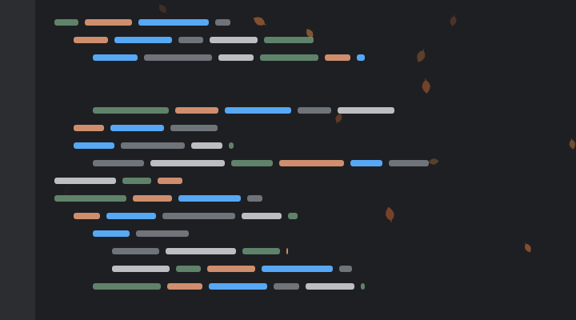

# IDE Atmosphere

[](https://github.com/sponsors/hsz)

## Overview

IDE Atmosphere is an IntelliJ Platform plugin that paints a quiet, living layer across the whole project frame (editor,
tool windows, header and status bar): **Fireflies** on a summer night, **Sakura** petals in a spring breeze, softly
falling **Snow**, fine **Rain**, a twinkling **Starfield**, swinging **Autumn Leaves**, rising **Bubbles** or
**Dust Motes** floating in a beam of light. It never intercepts input and never changes editor content, PSI or
languages. The overlay is a `Painter` on the frame's existing `IdeGlassPaneImpl`; see
[docs/overlay-investigation.md](./docs/overlay-investigation.md) for the platform investigation behind that choice.

> **Free and sponsor-supported.** If you enjoy IDE Atmosphere, consider supporting its development via
> **[GitHub Sponsors](https://github.com/sponsors/hsz)**, **[Ko-fi](https://ko-fi.com/hszanowski)**, or **[PayPal](https://paypal.me/hsz)**.
> You can also find my other projects on [GitHub](https://github.com/hsz).

| Fireflies | Sakura | Snow | Rain |
|---|---|---|---|
|  |  |  |  |
| **Starfield** | **Autumn Leaves** | **Bubbles** | **Dust Motes** |
|  |  |  |  |

Dark- and light-theme stills (`<id>-dark.png`, `<id>-light.png`) live next to the GIFs in [docs/media](./docs/media);
the Development table below shows how to regenerate them.

## What it does

- **Eight atmospheres on every project window.** Wandering, breathing fireflies; drifting, tumbling Sakura petals;
  layered snowflakes with depth (near ones larger, brighter and faster); rain streaking down in depth layers and
  splashing where the near drops land; a slowly drifting, twinkling starfield with a rare shooting star; warm autumn
  leaves swinging down like a pendulum; thin bubbles wobbling upwards; or tiny dust motes hanging almost still and
  shimmering in the light. Each
  covers the whole `IdeFrame` — editor, tool windows, empty editor area, toolbar/header band and status bar. The count
  scales with the window area and the field is rebuilt on resize.
- **Never in the way.** The overlay is a `Painter` on the frame's existing `IdeGlassPaneImpl`: passive cursor
  observation never consumes mouse events, enables an input target or changes the cursor. Popups, completion, Search Everywhere,
  dialogs and floating tool windows are separate windows, so particles always stay behind them.
- **Theme aware.** Palette derived from the current LaF (`JBColor.isBright()` + panel background luminance) and
  refreshed on theme change: every atmosphere has a dark and a light variant (warm amber / deep amber fireflies,
  soft pink petals, white / blue-grey snow, cold white / slate-blue stars). Optionally a different atmosphere for
  light and for dark themes.
- **Smooth.** Fireflies are rendered at sub-pixel positions (float geometry, antialiasing, `STROKE_PURE`) at a
  governed 20–30 FPS with real `deltaTime`, so they glide instead of hopping between pixels.
- **Plays with the pointer — without ever touching input.** In *Avoid* mode particles within 180 px of the pointer
  accelerate smoothly away from it (up to 120 px/s right under the cursor) and glide back into their own motion once
  it has moved on; in *Attract* mode they gather around the pointer and hover just outside a small stop radius; *Off*
  ignores it. A mouse click puffs nearby particles outward. Everything is observed through a passive
  `AWTEventListener`, so clicks and movement reach the IDE unchanged; this is independent of activity reactions.
- **Reacts to the IDE — with motion, never with colour.** When the debugger stops on a breakpoint (or after a step)
  the field holds still almost completely, as if holding its breath, until the session resumes. Any background task
  shown in the status bar for more than about a second, indexing, project builds, Run/Debug processes and external
  project sync/tasks (including Gradle) speed the particles up while they run. A success makes the whole field rise
  for a moment (fireflies lift and brighten, petals and snow ride an updraft, rain eases, a shooting star crosses the
  sky); a failure scatters the fireflies, sends one gust through the petals, flakes and drops or makes the sky shiver
  while everything dims briefly. Test runs report their own outcome from the result tree (all passed / any failed). Cancelled
  external tasks, aborted builds and stopped test runs finish neutrally, and a Gradle run is reported exactly once.
  After 30 s without input (`IdleTracker`) particles slow down and animation drops to 15 FPS; input restores normal
  motion.
- **Follows your typing.** Keystrokes feed a smoothed rhythm: fast typing stirs the particles up to 1.5× their speed
  and a pause lets them settle again within a few seconds. Keys are only observed, never consumed.
- **Cheap when unattended.** One small repaint rectangle per moved firefly, all painted in a single back-buffer
  flush (never a whole-window repaint during animation); an adaptive governor keeps the tick cost under ≈ 10 % of
  one core by lowering the rate to 20 FPS first. When the IDE application is deactivated the atmosphere fades out
  over 0.5 s and the animation timer stops (0 % CPU) until activation fades it back in; fully frozen while the frame
  is hidden or iconified, Power Save mode is on or the atmosphere is snoozed from the status bar.
- **Reduce Motion.** One switch makes every atmosphere very slow and low-frame-rate, with no success bursts, failure
  gusts, click puffs or typing boosts — the picture stays alive without ever moving quickly.

### Toggle and status bar

`View | Appearance | Atmosphere` shows or hides the effect on all windows. The choice is persisted across restarts
(`PropertiesComponent`, key `ide.atmosphere.enabled`, default on).

The **Atmosphere** status bar widget shows the current atmosphere (or *paused*) and opens a popup to switch to any
other one, **Pause for 1 Hour** (resumable at any time; the snooze is not persisted), open the settings page or
**♥ Sponsor IDE Atmosphere**.

### Settings

`Settings | Appearance & Behavior | Atmosphere` is deliberately small:

- **Atmosphere** — Fireflies, Sakura, Snow, Rain, Starfield, Autumn Leaves, Bubbles or Dust Motes, with a one-line
  description of the selected one and a **live preview** that runs it with the drafted intensity and speed before
  Apply (it animates only while the page is shown and never touches the open windows).
- **Intensity** (Subtle … Vivid) and **Speed** (Calm … Lively) sliders. Intensity changes opacity and population on
  the next animation tick without a resize; speed scales normal, idle and busy motion alike.
- **React to IDE activity**, with **Preview success** / **Preview failure** buttons that play the reactions on the
  open windows right away (they work even while automatic reactions are off and never save anything), and **React
  to typing** for the keystroke rhythm.
- **Mouse pointer** — *Particles avoid the pointer*, *Particles gather around the pointer* or *Ignore the pointer*
  (clicks puff particles in the first two modes).
- **Pause when the IDE window is in the background** and **Reduce motion**.
- **Light and dark themes** — an optional separate atmosphere for light and for dark themes (*Same as above* by
  default).

Reaction timings are built into each atmosphere and tuned to feel natural; there is nothing to configure there.
Changes stay drafts until Apply, Reset reloads the saved values and Cancel discards them. Everything is persisted in
`ideatmosphere.xml`; the 1.x `avoidMouse` flag is migrated to the pointer mode (`false` → *Ignore the pointer*).

### Debug statistics

Start the IDE with `-Dide.atmosphere.debug=true` (the `runIde` Gradle task sets it) and every 10 s `idea.log` gets a
line such as

```
atmosphere: ticks=218 fps=21.7 (governed 24, normal) tick avg=4295µs max=22708µs rects/tick=9.8 (nested 8.8, direct 1.0) px/tick=86541 cpu≈9.34%
```

— ticks in the period, effective and governed FPS, rate mode (`normal` / `calm` / `fading`), tick cost, repaint
rectangles per tick split into those painted inside the nested single-flush batch (`nested`) and directly
(`direct`; a healthy batch shows `nested ≈ rects − 1`), painted user-space pixels per tick, and the tick cost as a
share of one core. No lines are logged while the atmosphere is dormant (application deactivated).

## Architecture

```
AtmosphereProjectActivity ──attach──▶ AtmosphereManager (app service)
AtmosphereProjectService ──dispose─▶   │  frame registry · shared AtmosphereTicker · isEnabled · pause reasons (Power Save, snooze)
LafManager / PowerSave / Activation ──▶ │  publish(event) fan-out · IdleActivityProducer (IdleTracker.events)
ToggleAtmosphereAction ──isEnabled──▶  │  setFlow(level) fan-out · TypingRhythmProducer (passive key observation)
Status bar widget ──switch/snooze──▶   │
                                        ▼
                         FrameAtmosphere (one per IdeFrame)
                           effect.update(dt) ──▶ DirtyRegionCollector ──▶ contentPane.paintImmediately(rect 1)
                                                                      │     └─▶ painter hook ──▶ paintImmediately(rects 2..n) nested
                                                                      └─▶ rootPane.repaint(header rect)
                           IdeGlassPaneImpl ──▶ AtmospherePainter (opacity, depth ≤ 2) ──▶ effect.paint(g, clip)
```

| Package | Contents |
|---|---|
| `core` | `AtmosphereEffect`, `AtmosphereEvent`, `AtmospherePalette`, `PointerMode`, `EffectContext`, `AdsrEnvelope` (smooth reaction envelopes), `CursorAvoidance` (shared avoid / attract steering and click bursts) — effect-agnostic, Swing-only contracts |
| `render` | `AtmospherePainter` (glass-pane painter with fade opacity and the one-shot nested-paint hook), `DirtyRegionCollector` (cost-model region merging), `FrameBudgetGovernor` (adaptive 20–30 FPS), `AtmosphereTicker` (shared Swing timer, calm mode, dormant notification), `AtmosphereStats` |
| `frame` | `FrameAtmosphere` — one effect on one root pane, nested batch repaint routing, passive pointer / click observation, fade-out/fade-in and dormancy |
| `effects` | `AtmosphereEffects` registry, `fireflies/FirefliesEffect`, `sakura/SakuraEffect`, `snow/SnowEffect`, `rain/RainEffect`, `starfield/StarfieldEffect`, and `autumn/AutumnLeavesEffect`, `bubbles/BubblesEffect`, `dust/DustEffect` on the shared `common/DriftingParticleEffect` base (structure-of-arrays, allocation-free hot path) |
| `settings` | Persisted state, the settings page and its `AtmospherePreviewPanel` |
| `project`, `listeners`, `events`, `actions`, `widget` | Lifecycle wiring, platform listeners, idle, typing, build, execution, debugger, background-task, indexing, external-system, test-result producers, `ToggleAtmosphereAction`, the status bar widget |

Adding another atmosphere means implementing `AtmosphereEffect` (or, for independent drifting particles, extending
`DriftingParticleEffect` with spawn, drift and paint hooks) and registering it in `AtmosphereEffects`; adding an
IDE integration means publishing `AtmosphereEvent`s through `AtmosphereManager.publish` (or `publishOutcome` for a
plain success / failure). Neither touches the painter, the ticker or the lifecycle code. The debugger
producer lives behind the optional `com.intellij.modules.xdebugger`
descriptor (`META-INF/ideatmosphere-xdebugger.xml`), so IDEs without it still load the plugin. Background tasks are sampled
from the project's status bar once a second (`BackgroundTaskActivityProducer`), because the platform's task-start
listener is internal API; sampling stops with *React to IDE activity* off and skips ticks while the IDE is in the
background.

## Limitations (proof of concept)

- No atmosphere on floating tool windows, detached editor windows, the Welcome screen, dialogs or popups.
- Activity integration does not observe terminal commands, and background tasks that are not shown in the status bar
  (or finish within about a second) are not noticed. External-system notifications cover Gradle sync/tasks;
  Maven-specific sync is not verified.
- A test run whose process exit code agrees with its result tree reacts twice in quick succession (once from the
  runner, once from the process), which reads as a slightly longer reaction.
- While the overlay is visible, ordinary IDE repaints pay a ≈ 5–10 % overhead (the same as IDE background images).
- CPU cost (1512×949 @2x, 24 fireflies): ≈ 8–11 % of one core while the user is active at 20–24 FPS (smoothness was
  deliberately prioritised over the original 3 % target), ≈ 6 % while the user is idle (15 FPS, half speed), 0 %
  while the IDE application is deactivated. Measurements are recorded in
  [docs/overlay-investigation.md](./docs/overlay-investigation.md) §10.
- The single-flush saving of the nested batch repaint needs Swing's `BufferStrategyPaintManager`
  (`swing.bufferPerWindow=true`; verified on macOS/Metal). On other pipelines every rectangle pays its own blit and
  the governor settles at 20 FPS.

## Support development

Donation links are also available in **Settings → Appearance & Behavior → Atmosphere**. The Atmosphere status-bar
menu includes **♥ Sponsor IDE Atmosphere**, which opens GitHub Sponsors; the same action is available in Find Action.
Donations are optional; all plugin features remain free.

A sponsorship reminder can appear only after at least **10 project openings with Atmosphere enabled** and
**14 days since first use**. Disabled Atmosphere, default projects, headless runs and unit tests do not count.
**Remind me later**, or closing the reminder, snoozes it for **90 days**; **Don't show again**, or selecting a donation
provider in the reminder, stops future reminders permanently. Timing and reminder choices are stored locally in
`ideatmosphere-sponsor.xml` and are not synchronized or sent anywhere.

Marketplace release notes also include a sponsorship notice.

## Development

| Command | Purpose |
|---|---|
| `./gradlew test` | Unit tests (collector, governor, effects, envelopes, producers) and platform tests (`BasePlatformTestCase`) |
| `./gradlew runIde` | Sandbox IDE with the plugin and debug statistics enabled |
| `./gradlew verifyPlugin` | Plugin Verifier against the configured IDE versions |
| `./gradlew build` | Compile, test and package |
| `./gradlew test --tests '*MarketplaceMediaGenerator' -Pide.atmosphere.media.dir=docs/media` | Re-render the screenshots and GIFs in `docs/media` (skipped in ordinary test runs) |
| `./gradlew signPlugin` / `publishPlugin` | Sign and upload a release; credentials come only from environment variables |

Releasing: [`docs/release/RELEASE.md`](docs/release/RELEASE.md) (signing key, Marketplace upload, every later release)
and [`docs/release/LAUNCH-KIT.md`](docs/release/LAUNCH-KIT.md) (trailer and Shorts scripts, social posts, schedule).

## Plugin structure

```
.
├── docs/overlay-investigation.md   Platform investigation and measurements
├── docs/media/                     Screenshots and GIFs for the README and Marketplace listing
├── docs/release/                   Release checklist and launch kit
├── src/main/kotlin/info/chrzanowski/ideatmosphere/
│   ├── core/ · render/ · frame/ · effects/ · project/ · listeners/ · events/ · actions/ · widget/
│   ├── AtmosphereBundle.kt · AtmosphereManager.kt
├── src/main/resources/META-INF/plugin.xml   Plugin manifest (activity, listeners, action, status bar widget)
├── src/main/resources/META-INF/ideatmosphere-xdebugger.xml   Optional debugger descriptor
├── src/main/resources/messages/             Message bundle
├── src/test/kotlin/...                      Tests mirroring the main packages
├── build.gradle.kts · settings.gradle.kts
└── CHANGELOG.md · README.md · LICENSE
```

The plugin logo is `src/main/resources/META-INF/pluginIcon.svg`; Marketplace screenshots come from `docs/media`.

## Links

- [IntelliJ Platform Plugin SDK](https://plugins.jetbrains.com/docs/intellij)
- [IntelliJ Platform Gradle Plugin](https://plugins.jetbrains.com/docs/intellij/tools-intellij-platform-gradle-plugin.html)
- [JetBrains Marketplace Quality Guidelines](https://plugins.jetbrains.com/docs/marketplace/quality-guidelines.html)
